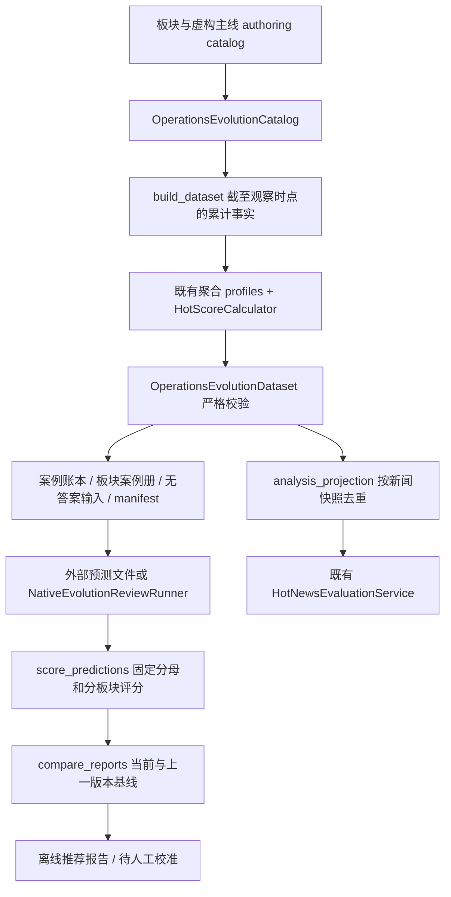

# 分板块运营数据与新闻主线评测

日期：2026-10-10。建设目标是每个运营人员独立积累经验，审核后再推广共享；新闻判断需要跟随同一主线的事实变化。本次实现分板块合成参考包及可运行的离线评测链路，没有修改生产策略或生成真实审批。

旧版入口仍在 [48例运营策略案例册](../../evaluation/datasets/operations_synthetic_v1/operations_casebook.md)，覆盖12类 OPS 策略、24个对比事件组。新版入口是 [板块索引](../../evaluation/datasets/operations_evolution_v2/README.md)，可直接查看各板块的完整案例和无答案输入。

## 数据覆盖

新版版本为 `2026-10-10.synthetic-evolution-v2`：12个板块、12个模拟运营作用域、36条独立虚构主线；每条主线6次观察，每次观察有2个不同候选，共216个新闻快照、432条运营判断。

| 板块 | 判断重点 | 示例主线 |
|---|---|---|
| 国内 | 公告归因、适用范围、办理窗口 | 公共服务补助、图书服务、预约调整 |
| 国际 | 多方归因、翻译、时区与地区范围 | 航线中断、文化交流、机场流程 |
| 财经 | 财务口径、样本范围、收益与因果边界 | 季度披露、债券兑付、价格调查 |
| 科技 | 测试与正式版本、兼容性、评测分母 | 系统升级、安全补丁、模型测试 |
| 社会 | 指控核验、隐私、调查与结论区分 | 临时疏散、公益审查、救助站搬迁 |
| 本地 | 受影响地域、服务期限、替代路径 | 供水维护、公交绕行、场馆预约 |
| 体育 | 临时与正式结果、赛程、球迷受众 | 决赛延期、纪录认证、主场改址 |
| 娱乐 | 传闻与确认、票务时间、准确表达 | 影展延期、乐团演出、纪录片上线 |
| 文化 | 出处归属、学术限定、预约权益 | 专题展、古籍数字化、遗址研究 |
| 教育 | 报名条件、未成年人隐私、批次 | 考试报名、学校开放日、助学申请 |
| 健康 | 研究与诊疗区分、因果限定、批次 | 健康预约、观察研究、设备检查 |
| 天气 | 预警区域、更新时点、解除与更正 | 大风、降雨、高温服务安排 |

六阶段是覆盖设计：待核验 → 已确认 → 重要进展 → 重复报道 → 过期/降温 → 更正。真实新闻不一定沿此路径发展，可能跳过、反复或长期没有结论。本包不估计真实新闻的阶段比例。

每条主线都有带时间的累计事实、聚合指标、候选文案、人群、渠道、发送窗口、频控/订阅/同意/静默条件，以及参考决定、分类、必需/可选理由码、可接受替代动作和修改字段。例如，财经确认信息也可能因静默而延后；体育临时成绩不能冒充正式认证；天气预警解除后不能继续沿用旧通知；社会调查不能写成违法已经坐实。

所有实体和新闻发展均为虚构，来源使用 `synthetic://`。全部保持 `generated_pending_review`、`not_executed`、`research_seed_not_production_policy`，没有真实用户行为、投递收益、审批人或批准标签。

## 完整调用链



上游入口 [run_operations_evolution.py](../../evaluation/run_operations_evolution.py) 的 `build` 命令读取版本化 [operations_evolution_v2.json](../../evaluation/seeds/operations_evolution_v2.json)。[operations_evolution_seed.py](../../evaluation/operations_evolution_seed.py) 保存可复现的情景编写逻辑；不是实时新闻抓取器。新增板块或改标签应生成新版本和新目录，再重跑评测，不能覆盖已经发布的不同内容。

核心 [operations_evolution.py](../../evaluation/operations_evolution.py) 的 `build_dataset()` 累计当前可见事实，派生稳定、无参考动作暗示的作用域/主线/事件/新闻/案例 ID。指标复用旧合成包的聚合 profiles、`NewsMetricSnapshot` 和 `HotScoreCalculator`；CTR、基线、分量及总分由 Python 复算。它们是测试输入，不是企业运营阈值。

`OperationsEvolutionCatalog` / `OperationsEvolutionDataset` 拒绝未来证据、缺失来源、阶段乱序、历史事实消失或变更、作用域错配、重复 ID、同主线跨 split、指标篡改和伪造审批状态。`blind_case_input()` 使用明确字段白名单移除答案、修订参考、split、层和编写键；模型只得到截至当前阶段的事实与候选。每个案例独立调用，不自动携带上次模型判断。

`write_artifacts()` 预检全部输出，只允许重复写入完全相同内容；`verify_artifact_hashes()` 同时验证文件清单、哈希、完整账本及所有投影的重建一致性。清单用于发现误改，不是审批签名或防止恶意重签名的安全机制。

下游有两条评测：

- **热点分析合同**：`analysis_projection()` → 既有 `load_evaluation_dataset()` / `HotNewsEvaluationService`，检查分析结构、确定性主驱动、指标覆盖、证据和限制说明。两条运营候选共用一个新闻观察；全量216例，每 split 72例，避免重复计算分析分母。
- **运营候选判断**：[operations_evolution_eval.py](../../evaluation/operations_evolution_eval.py) 的 `score_predictions()` 检查决定、反馈类别、理由码、原候选阻断、修改字段与合法证据；报告总体及板块/运营人员/阶段/主线/split成绩。缺答按所选案例完整分母记失败，未知/重复 ID 或作用域哈希错配直接报错。引用未来或未知证据、错误接受需要阻断的候选计入关键失败。

`NativeEvolutionReviewRunner` 通过已有 `InferencePort` / `StructuredInferenceService` 运行严格 `ModelDecision` Schema；离线 Prompt 单独在代码中绑定版本和哈希，不改变生产 Prompt。外部模型只能返回判断，案例 ID 与作用域由程序绑定。改稿评分目前只验证字段覆盖，不验证改稿语义。

## 数据分组与门禁

`development`、`validation`、`test` 各144条运营候选；每个板块各留一条完整主线在每个 split，同主线全部阶段和对照候选不得拆开。开发集用于调试，验证集用于选择方案，测试集用于冻结方案比较。这个划分仍共享合成写作模板，不能证明真实新闻泛化。

Golden 239、Fresh 73、HighRisk 120 是**候选用途标签**，不是正式 DataLoop 冻结层。Fresh 仅收分析错误且分析预期错误/部分错误的候选；策略或编辑判断不混入。两个候选可能属于不同层，因此各层分析投影可能包含相同新闻观察，不能作为互斥训练/验证/测试集，也不能跨层把分数相加。

`compare_reports()` 比较同一数据集与同一所选案例上的 candidate/current/previous；CLI 会从预测文件重新评分再比较。版本化 [离线 test 门禁样例](../../evaluation/seeds/operations_evolution_gate_v2.json) 要求总量至少144、每个分组至少12、全量覆盖、每组通过率至少90%、零关键失败、相对两版基线回退不超过2个百分点。阈值是待校准的离线实验参数；门禁通过仅输出 `offline_recommendation`，`production_activation_authorized` 始终为 false。

“主线通过率”表示所选主线的所有阶段和候选均符合参考合同；它不等于真实多轮状态推理或跨天 Memory 的质量。

## 命令与配置

在仓库 `agent/` 目录执行。前三条不需要网络、数据库、Temporal 或模型密钥：

```bash
python -m evaluation.run_operations_evolution build
python -m evaluation.run_operations_evolution validate --verify-artifacts
python -m evaluation.run_hot_news_eval --dataset evaluation/datasets/operations_evolution_v2/hot_news_analysis_test.json

python -m evaluation.run_operations_evolution score --split test --predictions /absolute/path/predictions.json --output /absolute/path/score.json
python -m evaluation.run_operations_evolution compare --split test --candidate /absolute/path/candidate.json --current /absolute/path/current.json --previous /absolute/path/previous.json --policy evaluation/seeds/operations_evolution_gate_v2.json --output /absolute/path/comparison.json
```

`--board-id finance` 等可选单板块；`--owner-user-id` 使用盲输入的 `scope.user_id`，匹配为空会报错。`--catalog`、`--dataset`、`--output` 控制版本源与产物位置。预测文件为数组，或带 `predictions` 数组的模型运行结果；每项合同如下，ID/哈希必须取自当前盲输入：

```json
{
  "case_id": "来自输入的case_id",
  "scope_sha256": "来自输入的64位作用域哈希",
  "decision_type": "deferred",
  "operator_feedback": {
    "category": "strategy_judgment",
    "reason_codes": ["insufficient_evidence", "risk_requires_escalation"]
  },
  "blocked": true,
  "evidence_news_ids": [],
  "revision_fields": [],
  "revision": null
}
```

需要真实接口实验时，显式使用已有模型 YAML 声明的端点、批准路由及密钥环境变量名；密钥由进程环境提供，不读取 `.env`。缺密钥、未注册路由或 local provider 失败关闭。当前本地分析替身没有运营审核场景，不自动回退。

```bash
python -m evaluation.run_operations_evolution run-model --runtime-config /absolute/path/model-runtime.yml --model-route approved-route --split test --board-id finance --max-cases 12 --output /absolute/path/experiment.json
# 同一实验中断后可加 --resume；输出和输入配置必须相同
```

`run-model` 默认 test、最多200条，显式预算上限2000；每个未尝试案例串行有界调用一次。输出旁的 `.progress.json` 每次写入已验证预测或仅含异常类型的诊断；不存原始模型响应或异常正文。`--resume` 绑定数据、所选案例、配置、路由、Prompt 和实验身份；已经失败的案例仍记缺答，不偷偷重试。需要重新尝试应建立新实验。硬崩溃时未保存的最后一次请求可能重发，实际幂等保障取决于端点合同。

依赖 Python、Pydantic、已有指标/反馈 Schema 和原生模型运行时；可选真实运行还用 YAML、HTTP 客户端及企业推理接口。离线生成/校验/评分没有模型副作用。本次没有调用企业模型。

## 验证与后续接入

测试入口是 [test_operations_evolution.py](../../tests/test_operations_evolution.py)，覆盖板块与阶段分布、时间可见性、事件分组、个人作用域、盲输入、确定性指标、固定分母、门禁回退、产物误改、模型合同、诊断清理和断点续跑。既有分析评测器通过合同夹具读取72个 test 快照；夹具满分只证明评测器合同可用，不代表模型质量。

本次20个相关模块回归为 `324 passed, 2 skipped`，其中新增主线评测39项通过；两项真实 Temporal 分析回放因未启用专用测试环境而跳过。旧48例包与新版49个产物均通过重建/哈希检查，分析 loader 读取72例 test 投影成功。测试进程显式关闭 Settings 的 dotenv 读取。

```bash
PYTHONDONTWRITEBYTECODE=1 python - <<'PY'
import pytest
from app.config import Settings
Settings.model_config['env_file'] = None
modules = ['operations_evolution', 'operations_synthetic', 'hot_news_evaluation',
           'operations_feedback', 'dataset_freezer', 'feedback_collector',
           'evaluation_gate', 'offline_replay']
raise SystemExit(pytest.main([f'tests/test_{name}.py' for name in modules]
                            + ['-o', 'addopts=', '-q']))
PY
```

下一步应先由各板块运营复核参考决定、理由与替代动作，补真实匿名聚合样本及没有重要进展/反复更新/跨天的非模板主线；对保留 test 控制调参次数，再跑批准模型的 current/previous/candidate。真实采纳率、触达效果和改稿语义需独立验收，不能从本包分数推导。

正式 DataLoop 仍需：已完成热点 run/report → `HotNewsDecisionService.record()` → 同事务 `AnalysisFeedbackCollector` → 待标注案例 → 标签提交/独立二审 → `EvaluationDatasetFreezer` → 回放/Gate → 人工版本批准。当前包只复用 Schema 和评测合同，没有伪造 run 或导入正式账本。需补关联真实 run 的导入适配、主线血缘、迟到标签回补和人工复核事件。

个人策略的生产身份隔离、同一板块多运营人员、个人→共享的审核/撤销/版本注册表、批准策略参与下一次建议、可信频控/订阅/同意来源以及模拟/真实投递仍是 TODO。本包中的作用域用于离线评测约束，不能代替线上 API 的权限校验。
