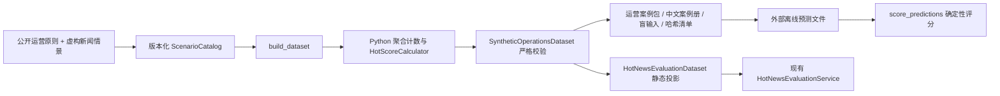

# 合成运营反馈与评测扩集

日期：2026-10-10。用户确认平台模拟腾讯新闻内部业务、无法提供真实团队反馈，因此本批使用虚构新闻情景、模拟编辑意见和程序生成的评测预期。它是可复现的离线素材包，不是腾讯内部策略、真人标注或正式二审通过数据。

## 新闻运营判断如何生成

先回答六个问题：事实是否可靠、是否值得打扰、对谁有价值、现在是否仍有用、相对上次是否有重要增量、通知文案自身是否准确。CTR 和热度提供观察，不能单独决定推送。

这个判断框架是对公开资料与本项目策略目录的综合映射。Reuters Institute 强调相关性、个人选择以及过量和耸动通知对信任的影响；AP 要求短通知也保持必要上下文和归因，编辑原则要求核验和更正。[Reuters 通知研究](https://reutersinstitute.politics.ox.ac.uk/digital-news-report/2025/walking-notification-tightrope-how-engage-audiences-while-avoiding)、[AP 短通知](https://www.ap.org/the-definitive-source/behind-the-news/the-challenge-of-brevity-in-the-digital-age/)、[AP 编辑原则](https://www.ap.org/about/news-values-and-principles/telling-the-story/)。查阅日期为2026-10-10。

| 策略 | 案例要检验的区别 |
|---|---|
| OPS-01 新闻价值与准确性 | 有公共价值与仅有流量；可靠事实与传闻 |
| OPS-02 重大突发 | 紧急程度与影响范围；确认数字与误用数字 |
| OPS-03 地域/兴趣 | 受影响人群与泛化人群；实体/地域匹配 |
| OPS-04 明确订阅 | 有效订阅与撤销/未知权限 |
| OPS-05 事件增量 | 新事实与文章换标题；事件身份与文章身份 |
| OPS-06 时机/有效期 | 仍可行动与已过期；延期后重新核验 |
| OPS-07 频控/疲劳 | 有可信余量与额度用尽/未知；事件总预算 |
| OPS-08 准确文案 | 带归因的预测与确定事实；标题/证据一致 |
| OPS-09 渠道/偏好 | 合适且允许的渠道与偏好冲突/敏感锁屏 |
| OPS-10 日报/专题 | 非紧急内容合并与重大突发被拖延 |
| OPS-11 更正/撤回 | 明示错误与掩盖错误；撤回能力与平台回执 |
| OPS-12 效果验证 | 分母/观察窗完整与CTR单指标、无对照因果 |

案例中的频控、静默和人群条件若有具体参数，均为明确写出的本地情景假设。公开资料不提供腾讯新闻的实际阈值、内部受众规则或推送收益。研究来源只支撑运营原则；虚构新闻的事实来源是同一案例的 `facts`，没有伪造真实新闻URL。

## 已生成的素材

每类策略4例、2个对比组，总计48例、24个独立事件组。建议分层为 Golden 24例、Fresh 8例、High-risk 16例。同一个对比组的两例始终在同层；这些层名表示候选用途，仍须复核后才能变成正式冻结集。

决定分布：采纳12、驳回13、延后10、修正13。分类分布：正例12、编辑判断8、分析错误10、策略判断18；其中2个分析错误保留在高风险候选层，Fresh为另外8例。

素材位于 [`evaluation/datasets/operations_synthetic_v1/`](../../evaluation/datasets/operations_synthetic_v1/)：

| 文件 | 用途 |
|---|---|
| [operations_casebook.md](../../evaluation/datasets/operations_synthetic_v1/operations_casebook.md) | 中文阅读版：事实、建议、人群/渠道、模拟反馈、修订和研究依据 |
| [operations_cases.json](../../evaluation/datasets/operations_synthetic_v1/operations_cases.json) | 48例完整结构化反馈素材、分析输入与预期、聚合基线和血缘 |
| [operations_inputs.json](../../evaluation/datasets/operations_synthetic_v1/operations_inputs.json) | 运营离线预测输入，不包含expected、verdict、revision、分层和对照答案 |
| [hot_news_analysis_all.json](../../evaluation/datasets/operations_synthetic_v1/hot_news_analysis_all.json) | 48例现有热点分析评测器可读取的独立静态评测集 |
| `hot_news_analysis_{golden,fresh_bad_case,high_risk}.json` | 按事件组拆分的分析评测投影，分别24/8/16例 |
| [manifest.json](../../evaluation/datasets/operations_synthetic_v1/manifest.json) | 数量、类别、决策分布、源目录哈希及所有产物的SHA-256 |

四种决定的含义：采纳是认可候选建议；驳回是此次建议不适用；延后是待明确条件满足后再审核；修正是提供修改草稿。所有例子均为 `synthetic=true`、`generated_pending_review`、`not_executed`，没有审批人或已发送结果。

运营动作与分析质量单独记录。例如分析事实正确，但将地方消息推向全站，可归为 `strategy_judgment`；缺少新闻价值可归为 `editorial_judgment`；编造数字/因果/归因才是 `analysis_error`。Fresh 的8例都具有分析错误和 incorrect/partially_correct 预期，程序拒绝将频控驳回、正例或业务判断混入 Fresh。

## 完整调用链



上游入口是 [`run_operations_synthetic.py`](../../evaluation/run_operations_synthetic.py) 的 build 命令，读取 [`operations_scenarios_v1.json`](../../evaluation/seeds/operations_scenarios_v1.json)。`ScenarioCatalog` 校验策略编号、两例对比组、来源引用和Fresh资格；`build_dataset()` 使用稳定哈希派生不带动作/好坏暗示的公开案例、新闻和事件ID。

核心实现位于 [`operations_synthetic.py`](../../evaluation/operations_synthetic.py)。只生成聚合计数，不生成用户行为明细；`NewsMetricSnapshot` → `HotScoreCalculator.calculate()` 计算四分量与权威热度，CTR由计数计算。`validate_metrics()` 复算当前指标、基线、CTR、漏斗、总分、分量和主驱动预期；`SyntheticOperationsDataset` 校验事件不跨层、对比组事件一致、ID唯一及来源存在。四个聚合配置分别突出click/consumption/interaction/growth，共36篇article、12篇video；它们只是测试fixture，不能解释为本地或企业运营基准。

下游 `write_artifacts()` 写JSON、中文案例册和清单。`analysis_projection()` 转为既有 `HotNewsEvaluationDataset`，复用 `load_evaluation_dataset()` 与 `HotNewsEvaluationService`，检查分析Schema、主驱动、证据引用、指标覆盖和限制说明。分析输入保留情景事实，不包含候选错误主张或运营答案；评测预期由聚合分量推导，不根据本地模型替身改写。

运营反馈另用 `score_predictions()`，只比较四种决定、反馈类别和理由码。缺答按48例完整分母记失败；重复或未知ID报错；理由码顺序忽略、集合要求完全一致。这只是对模拟预期的一致性检验，不能证明最优策略、真实采纳率或CTR提升。合理的额外理由/替代决定需要人工校准预期，不能把种子答案当成唯一运营真理。

## 运行与配置

在仓库的 `agent/` 目录执行：

```bash
python -m evaluation.run_operations_synthetic build
python -m evaluation.run_operations_synthetic validate --verify-artifacts
python -m evaluation.run_hot_news_eval --dataset evaluation/datasets/operations_synthetic_v1/hot_news_analysis_all.json
python -m evaluation.run_operations_synthetic score --predictions /absolute/path/predictions.json
python -m pytest tests/test_operations_synthetic.py tests/test_hot_news_evaluation.py -o addopts= -q
```

预测文件为JSON数组，每项只需如下字段；case_id必须来自 `operations_inputs.json`，不能读取答案后生成模型成绩：

```json
[
  {
    "case_id": "替换为输入文件中的case_id",
    "decision_type": "deferred",
    "operator_feedback": {
      "category": "strategy_judgment",
      "reason_codes": ["timing_inappropriate"]
    }
  }
]
```

配置项为 `--catalog`、`--output`、`--dataset`、`--predictions` 和 `--verify-artifacts`；无新增环境变量。生成版本固定为 `2026-10-10.synthetic-v1`，时间窗固定UTC 2026-10-10 00:00–01:00（北京时间08:00–09:00）。依赖Python/Pydantic及项目既有计算/Schema模块，无数据库、Temporal、网络或模型调用；不会读取 `.env`。

`run_hot_news_eval` 默认只验集。显式 `--run-model` 才使用已有模型YAML和推理Port；本地确定性替身不代表模型质量。本次未报告模型准确率。

本次验证：16个相关后端测试模块共261项通过，其中新合成数据集测试45项。48例成品与当前源目录重建结果一致；JSON契约、全产物SHA-256、盲输入答案提示检查和跨层event/news/evidence隔离通过。静态分析评测loader读取48例成功。上述测试验证素材和评测链路，不是企业模型验收或投递效果测量。

## 与正式 DataLoop 的关系及 TODO

根目录 [`执行链路.md`](../../../执行链路.md) 的正式链路仍是：已完成热点运行 → `HotNewsDecisionService.record()` → 同事务 `AnalysisFeedbackCollector.collect_from_operator_decision()` → 待标注案例 → `submit_label()` → 独立 `approve_label()` → `EvaluationDatasetFreezer.freeze()` → Temporal回放/Gate → 人工配置批准与激活。本包从中复用反馈分类与Fresh判断，暂未写入这个正式账本。

未完成项：在隔离模拟租户生成并持久化真实可关联的热点run/report，再提供通用素材导入映射；由使用者复核模拟判断、给正式标签二审；补真正运营策略模型runner与评测维度；接可信预算/订阅撤销/静默校验及投递Port。不能虚构run_id、审批人或二审记录来跳过这些步骤。现有PushPolicyValidator也没有验证全部真实预算、偏好和静默条件，本包不声称这些能力已经完成。

人工校准或后续增加案例时另建版本，同时重新生成JSON/案例册/清单并校验哈希。不要覆盖已被正式评测引用的冻结版本。
