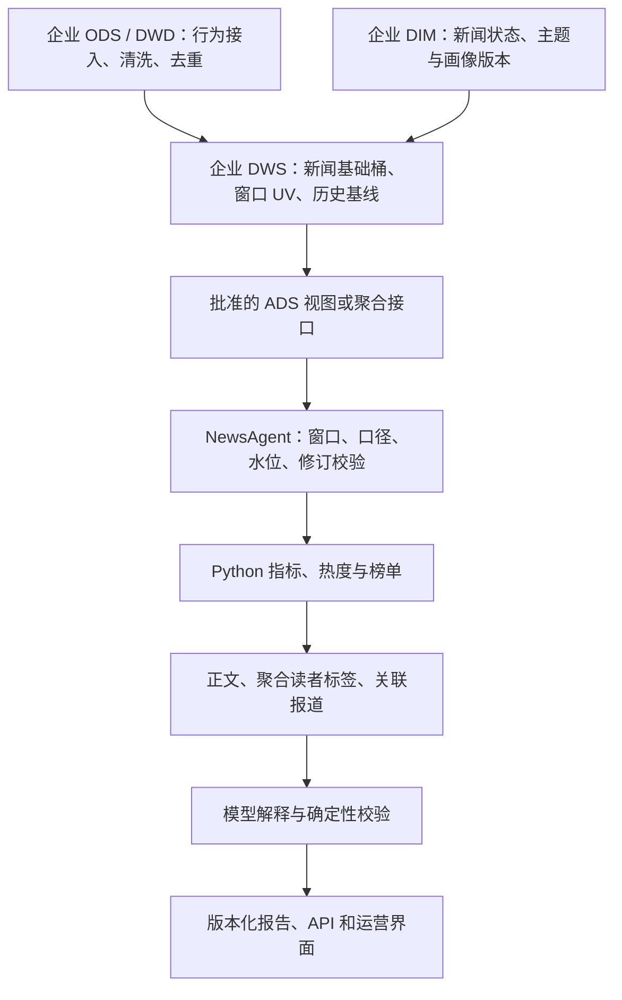

# NewsAgent 企业 TDSQL 数仓接入与字段设计

初始整理：2026-10-23；源码复核：2026-10-26。用途：保留企业接入合同与模拟模板，说明本地已实现的接口和企业接入仍需确认的内容。本地阶段以现有合成数仓完成架构与合同测试，企业连接不是本地推进的前置条件。

**已确认背景：用户于 2026-10-23 确认企业侧使用 TDSQL-A、PostgreSQL 兼容。具体内核版本、物理表名、连接方式和企业指标定义尚未提供。本文不是腾讯内部数据字典，也不是已经执行的建表方案。**

本文给出 Agent 需要的业务合同和建议补充项；[v8 DDL](sql/real-news-warehouse-v8.sql) 列出本地 v8 的 13 张表、183 个物理字段及 4 个视图。本文解释核心 18 列及口径，DDL 提供本地物理结构；新增快照、基线和内容状态字段须另行版本化。

实时数仓案例、时间粒度与本项目优化建议见[第 8 节](#realtime-window-design)。该节区分公开实践、当前源码和待实现方案，不改变现有查询窗口或运行配置。

## 1. TDSQL 背景如何影响方案

已确认的项目输入是 TDSQL-A、PostgreSQL 兼容方向。本文据此定义待映射合同；具体内核、启用特性和性能须由企业实例与接入测试确认。

接入设计沿 PostgreSQL 方言推进，可优先复用现有 SQL 编译、AST 校验和参数化查询合同；不再保留 MySQL 方言的并行方案。实际通过 PostgreSQL 协议直连还是企业 SQL 网关/SDK，由内部接入规范决定。兼容方向确定不等于本地 DDL 的所有触发器、约束和分布式执行行为已验证。

| 层次 | 本项目的职责与状态 |
| --- | --- |
| 企业 TDSQL-A 数仓 | 已确认 PostgreSQL 兼容；企业维护采集、清洗、去重和聚合，项目消费批准的聚合视图或指标接口。具体企业 DDL 待映射 |
| 数仓接入层 | 将企业字段映射为 NewsAgent 的指标合同，校验身份、窗口、版本、类型、质量和重复行；当前仓库尚未提供经企业验收的 TDSQL Adapter |
| Agent 应用库 | 保存运行、审批、报告、证据引用等业务状态；使用 PostgreSQL 的本地实现不等于企业数仓也已迁移为该实例 |
| 本地独立模拟数仓 | `news_sim_v8.*`，13 张表、183 列；真实公开正文配合明确标记的合成行为数据 |
| 本地 Agent 查询库 | `dw.*`，3 张业务表加 1 张 Schema 台账表；对 Agent 暴露 18 列只读视图。它是裁剪后的接口结构，不是独立 v8 的全部物理表 |

不必为了接入 Agent 重建企业的 13 张表。已有企业表或接口能提供同样的可信语义即可；字段改名、单位换算和版本筛选可以由受控视图或 Adapter 完成。

## 2. 首先对齐的 18 个字段

本节对应 `SQL_ASSISTANT_DATASET_PROFILE=real-news-v8` 的冻结合同 `news-warehouse-v7`，视图为 `dw.news_behavior_aggregate`。其他本地 profile 仍绑定各自冻结版本；v7 不是所有入口统一使用的版本。

**唯一粒度：一个租户、一篇新闻、一个完整小时。** 当前实际主键对应 `(tenant_id, news_id, event_time)`；`content_type` 是新闻属性，不允许以同一新闻出现两种类型来规避重复行校验。`event_time` 表示小时开始时间，不是原始行为时间，也不是入库时间。区间统一使用 `[window_start, window_end)`。

以下类型是当前 Agent 本地 PostgreSQL 合同；企业源字段名全部待核实。表中“非空”指对外合同要求，不能用默认值掩盖企业源字段缺失。

| 字段 | 当前类型 / 可空 | 含义、单位与来源 | 计算及评测约束 |
| --- | --- | --- | --- |
| `tenant_id` | `uuid` / 非空 | 业务访问域，由可信服务身份映射；不是读者 ID | 不由模型填写；所有关联、筛选与缓存都带此维度。企业使用 app_id/business_id 时需显式映射 |
| `news_id` | `text` / 非空 | 企业统一新闻标识，关联指标、正文、证据和报告 | 不用标题作主键；跨来源 ID 冲突必须先做映射，不能静默合并 |
| `event_time` | `timestamptz` / 非空 | 小时桶起点 | 必须有时区并整点对齐；当前热点榜只支持完整单小时 |
| `title` | `text` / 非空 | 新闻标题，来自内容维度 | 用于显示和关联检索；标题内文字不能改变 SQL 或系统指令 |
| `content_type` | `text` / 非空 | 内容类型 | Agent 表允许 `article/video`；当前 v8 数据和场景只允许 `article`，不能声称已有视频行为验收 |
| `category` | `text` / 非空 | 栏目 | v8 的科技、财经、体育、社会、汽车、教育、娱乐是演示标签；需映射企业正式栏目字典 |
| `source` | `text` / 非空 | 内容来源标记 | 不等同推荐/搜索/消息等流量渠道；不能用它计算渠道贡献 |
| `publish_time` | `timestamptz` / 非空 | 新闻发布时间 | 解析后保留时区；用于确定新闻何时具有统计资格，不能让发布前的行为进入结果 |
| `impressions` | `bigint` / 非空 | 合同定义下的曝光事件次数，单位“次” | 非负；相同规则、非重叠时间及互斥来源下可加；同一窗口不同修订不可相加 |
| `clicks` | `bigint` / 非空 | 点击事件次数，单位“次” | 非负；当前本地约束 `clicks <= impressions`，企业是否满足取决于点击与曝光归因，必须先核实 |
| `unique_users` | `bigint` / 非空 | **单新闻、单小时点击 UV**，单位“人” | 不是详情访问 UV；不得跨小时、渠道或新闻直接求和。当前本地还约束其不超过 clicks |
| `total_duration_seconds` | `numeric(20,2)` / 非空 | 阅读/消费时长合计，单位“秒” | 企业若提供毫秒，只能在一个确定的转换位置除以 1000；按合同过滤异常/重复时长。v8 原表是整数秒，导入此表转 Decimal |
| `effective_consumptions` | `bigint` / 非空 | 当前 v8 为点击归因的有效阅读次数，单位“次” | 不包含直接入口有效阅读；不是有效阅读人数。阈值与过滤规则由企业定义，不能自行填“读满 N 秒” |
| `interactions` | `bigint` / 非空 | 当前 v8 为点赞、评论、分享、收藏事件次数之和 | 不是互动 UV；不包含负反馈。不应重复叠加总互动和子项 |
| `baseline_impressions` | `numeric(20,2)` / 可空 | 曝光历史基线 | 当前 v8 使用过去最多 3 天的可用同小时样本均值；无样本为 NULL |
| `baseline_clicks` | `numeric(20,2)` / 可空 | 点击历史基线 | 不能用未来窗口或不同指标版本；0 与 NULL 意义不同 |
| `baseline_effective_consumptions` | `numeric(20,2)` / 可空 | 有效消费历史基线 | 与当前值使用相同单位、过滤与归因规则 |
| `baseline_interactions` | `numeric(20,2)` / 可空 | 互动历史基线 | 不混用“次”和“人”，不可把缺基线当零基线计算增长 |

当前 `dw.news_metric_baseline_hourly` 的物理基线列为 NOT NULL；v8 没有基线的新闻不导入基线行，通过视图 LEFT JOIN 得到上述 NULL。这与独立 v8 基线表“有行、sample_count=0、四列 NULL”的实现不同，输出语义一致。

另外三处当前实现差异必须单独处理：

1. `total_duration_seconds` 的数据库列支持两位小数，但 `NewsMetricSnapshot` 和通用指标源目前要求整数秒。企业返回 12.34 秒时不能默默截断；需要批准保留 Decimal、改用整数毫秒或明确取整规则，并同步更新合同和测试。
2. v7 的 `unique_users` 指点击 UV；旧 `NewsMetricCalculator` 的事件聚合对全部事件的 user_id 去重，读者画像又使用详情访问 UV。三条路径尚不能当作同一口径比较，评测要固定入口并标注用户集合定义。
3. 源包的 `sample_count` 是实际历史样本数；当前 SQL 热点补充链对存在基线写入 `sample_count=1`，仅表示一份合成参考。它不能替代企业历史样本数，也不能据此评价真实基线覆盖率。

**时间约定建议：** 接口传 ISO 8601 带偏移时间，内部比较统一 UTC；北京时间自然日按 Asia/Shanghai 明确换算。若企业使用不带时区的时间列，Adapter 必须按已确认源时区解释，禁止依赖服务器默认时区。历史新闻回放还需冻结当时可见的内容状态；当前 v8 的资格视图主要反映包内当前状态，不能自动证明具备任意历史时点查询能力。

## 3. 需要单独确认的指标公式

| 指标 | 建议合同 | 当前实现和限制 |
| --- | --- | --- |
| 点击率 CTR | `clicks / impressions`；输出比例，展示时乘 100% | 独立 v8 运营视图分母为 0 返回 NULL；Agent 部分现有路径使用 0 回退。接入与评测须明确所测入口，不能混用 |
| 点击归因有效阅读率 | `effective_consumptions / clicks` | 仅在二者使用相同归因口径时成立；0 分母返回不可计算。现有独立 v8 运营视图已有该值，18 列视图没有 |
| 每次详情访问平均时长 | `total_duration_seconds / detail_page_views` | 当前 v8 的时长是详情阅读时长，应用详情 PV 作分母；18 列视图缺少 detail_page_views，不能换用点击 UV 后仍叫“平均阅读时长” |
| UV | 在目标新闻、目标时间范围内对批准身份去重 | 小时 UV 不能推算日 UV；需要上游提供目标窗口去重结果。企业若采用近似算法，还需给出方法及误差说明 |
| 基线相对变化 | `(current - baseline) / baseline`，仅 baseline > 0 时计算 | baseline=0 标记零基线，NULL 标记无基线；不生成无穷增长率，不自行用 1 替换分母 |
| 互动率 | 先指定分母是点击、详情访问还是曝光，再定义公式 | 三者不是同一指标。当前合同未统一批准这一新增派生指标 |
| 热度 | 使用批准版本的 Python 热度规则，记录输入与版本 | SQL `hot_score` 是候选选择用的演示分数，不等于最终 Python 权威热度；不是 TDSQL 原生字段 |

数值型指标在 Python/SQL 中计算，模型负责解释和表达。不能让模型根据标题猜测缺失曝光、热度或历史基线。

## 4. 企业接入建议增加的字段

下列内容是**待实现的生产合同建议**。部分概念已经在独立 `news_sim_v8` 中存在，但没有随 18 列 `dw` 视图完整传递。不要直接给冻结 v7 视图加列，应另建合同版本或增加服务端结果元数据。

### 4.1 快照与口径元数据

建议随查询结果返回 `snapshot_metadata`；如一次包含多个小时，则按租户和小时返回多条元数据，不用一个 revision 冒充所有小时的统一版本。元数据不一定需要重复到每行。

| 建议字段 | 逻辑类型 / 必需性 | 精确定义与用途 | 当前对应情况 |
| --- | --- | --- | --- |
| `source_system` | string / 必需 | 实际来源系统与数据产品标识，区分企业、公开内容、模拟数据 | 查询结果合同需补齐；不能只靠文件名推断 |
| `schema_version` | string / 必需 | 字段和输出结构版本 | 本地有 `news_schema_contract.version`，企业版另建 |
| `metric_policy_version` | string / 必需 | 曝光、点击、有效消费、时长、UV 的口径版本 | 对应 v8 `policy_version`，18 列不含 |
| `dataset_version` | string / 回放必需 | 数据发布/冻结包身份；与 Schema 版本区别开 | 本地包 manifest 有身份信息，企业需提供对应引用 |
| `window_start` | timestamp / 必需 | 查询目标桶起点，与行中 event_time 一致 | 已有查询绑定参数 |
| `window_end` | timestamp / 必需 | 排他的桶终点 | v8 window_snapshot 已有 |
| `bucket_seconds` | integer / 必需 | 本次桶宽，当前热点合同为 3600 | 通用指标模板已有该配置；不等于源库字段 |
| `business_timezone` | string / 必需 | 解释自然日和同期基线的时区，例如 Asia/Shanghai | 当前依赖场景/代码，建议显式返回 |
| `snapshot_revision` | integer / 必需 | 同租户、同桶的单调修订号；每次修正产生新版本 | v8 已有，导入 dw 后丢失逐桶 revision 列 |
| `snapshot_at` | timestamp / 必需 | 本快照生成时间，不能等同查询执行时间 | v8 window_snapshot 已有 |
| `watermark_at` | timestamp / 必需 | 上游按其合同确认处理推进到的事件时间边界 | v8 已有；具体语义及迟到预算由上游定义，仅水位过窗不能自行证明所有来源齐全 |
| `completeness` | enum / 必需 | complete、corrected、incomplete；企业状态需显式映射 | v8 已有；热点完整窗口仅接受前两类且质量通过 |
| `quality_status` | enum / 必需 | passed、pending、failed 等质量判定；允许值需另定版本 | v8 仅 passed/pending；failed 是建议扩展，不是已有枚举 |
| `uv_method` | string / 返回 UV 时必需 | 实际去重对象、窗口、方法或其版本引用 | v8 的 `temporary_interval_union_v8.1` 仅为模拟方法，不能用于企业数据 |
| `data_origin` | enum / 必需 | enterprise_measured、synthetic 等指标来源 | 建议新增；v8 metric_data_synthetic 恒为 true，不能切为 false 后宣称已接企业 |
| `query_id` | string / 必需 | 企业执行记录或服务端查询追踪 ID | 用于定位超时、扫描量、资源消耗；不是原始用户标识 |
| `evidence_ref` | string / 回放必需 | 经授权聚合快照或结果摘要引用 | 供报告和评测追溯；不嵌入凭证或用户明细 |

**一致性要求：** 先确定最新修订，再判断其完整性和质量；最新修订不合格时应阻断，不回退较旧的 passed 版本。同一轮的候选查询、UV/时长补充和基线必须绑定一致快照。需要企业在单一一致性读取中返回结果，或提供可重读的快照令牌；仅增加 revision 字段而分多次读取仍不能消除修订竞态。

### 4.2 与新闻绑定的基线和内容信息

| 建议字段 | 逻辑类型 / 空值 | 精确定义与校验 | 当前对应情况 |
| --- | --- | --- | --- |
| `baseline_version` | string / 有基线时必需 | 基线方法版本，包含回看范围、样本筛选与聚合方法 | v8 基线表已有，18 列不含 |
| `baseline_sample_count` | integer / 非空 | 实际采用的历史样本数；0 表示没有基线 | 对应 v8 `sample_count`；不是配置的计划天数 |
| `baseline_reference_start` | timestamp / 无样本可空 | 基线候选历史区间起点 | 建议新增；不能仅从均值倒推 |
| `baseline_reference_end` | timestamp / 无样本可空 | 基线候选历史区间排他终点，不能超出目标窗口起点 | 建议新增；与起点共同定义可见历史范围 |
| `baseline_source_revisions_ref` | string / 有基线时必需 | 实际入选样本的时间与修订清单引用 | 建议新增，便于迟到修正后重算与复现 |
| `content_version` | integer/string / 非空 | 实际内容版本，类型服从源合同 | v8 已有整数版；企业若使用字符串版本不要强转整数 |
| `content_sha256` | string / 非空 | 对明确规范化正文计算的 SHA-256 | v8 已有；需冻结编码和清洗规则，否则相同正文也会有不同摘要 |
| `content_status` | enum / 非空 | published、withdrawn、restricted 的映射值 | 对应 v8 status；企业真实撤稿/授权状态必须由内容源提供 |
| `content_status_effective_at` | timestamp / 非空 | 内容状态生效时间 | 对应 v8 status_effective_at；不同于指标时间 |
| `lifecycle_revision` | integer / 非空 | 内容状态更新序号，用于拒绝乱序覆盖 | v8 已有；不是指标 snapshot_revision |
| `metric_available` | boolean / 非空 | 是否具备该数据版本下的指标证据 | v8 dim_news 已有，但 true 不代表任意小时都有数据，仍需检查目标窗口 |
| `source_url` | string / 可空 | 经批准可展示的来源 URL | v8 已有；企业无公开 URL 可返回授权内容引用，不能拼造网址 |

内容正文、关键词和索引任务不必全部放进 Text2SQL 视图。数仓给 news_id，内容服务再按 ID 提供正文；知识库按内容版本检索。受众画像也优先消费现有聚合 Port，不把 user_id、设备 ID 或逐用户行为加入上述接口。[读者聚合合同定义](../app/modules/reader_profiles/contracts.py)

## 5. TDSQL 物理适配：先确认再落地

| 项目 | 建议 | 落地前需要确认 |
| --- | --- | --- |
| 类型 | 沿 PostgreSQL 类型体系映射，保留计数整数、时长/均值精确小数及带时区接口时间 | 核对实际源列是否使用 uuid/text、timestamptz/timestamp、numeric，以及精度、源时区和驱动返回类型；源列无需与本地同名同类型 |
| 访问方式 | 优先企业批准的只读 SQL 网关/SDK 或现有指标 API | 协议、驱动、连接池、鉴权、取消查询和超时错误映射 |
| 时间分区 | 小时事实按事件时间做日期范围分区是候选方案 | 数据量、保留周期、迟到补数范围、分区裁剪能力与实际语法 |
| 数据分布 | 按真实连接键和热点分布评估 tenant/news 组合的分布方案 | 只按 tenant 分布在少量大业务域下可能倾斜；只按 news 分布会影响全站 TopK 的跨节点合并，需 EXPLAIN/实测 |
| 行列存储 | 宽范围聚合可评估列存；小维表、频繁单行更新单独评估 | 以该内部版本的可用能力为准，不把公开产品能力直接写成已上线优化 |
| 查询代价 | 对批准视图限制租户、时间、列、排序和结果量，并设执行预算 | LIMIT 只限制返回行，不能保证少扫描；还要检查扫描量、执行计划、并发和取消效果 |
| 权限 | 服务账号只读批准视图，按业务域隔离，记录查询审计 | 企业数据库/网关的实际权限机制；不能仅靠 Prompt 或 WHERE 条件证明隔离 |
| 修订 | 上游发布新快照，业务运行绑定版本，缓存包含版本 | 对迟到更新、撤稿和缓存失效进行同一次运行的一致性验证 |

当前聊天 SQL 编译器及 `SqlAssistantGuard` 明确使用 PostgreSQL 方言，与已确认的 TDSQL-A 兼容方向一致。通用 `Text2SqlSchema` 也可按 postgres 校验；连接执行、日期函数、小数除法、参数绑定、只读事务、超时和错误处理仍需企业合同测试。若允许 PostgreSQL 协议直连，现有 SQLAlchemy/psycopg 是可验证的适配起点；若要求网关/SDK，则实现同一 `SqlWarehouseClient` Port。**本文未新增驱动、TDSQL 连接或数据库迁移。**

## 6. 用这份字段设计准备评测

企业联调时先完成一份“核心字段映射 + 口径确认”。不必等所有扩展字段上线后才开始本地合同回归；但企业业务指标验收必须使用已确认的企业映射和批准聚合快照。

每个字段补齐以下内容：

| 记录项 | 填写示例或规则 |
| --- | --- |
| 逻辑字段 | 如 `unique_users` |
| 企业库 / 表 / 列 | 待内部确认；不可把本地表名当作真实企业表名 |
| 数据类型与转换 | 如 bigint；是否可能为字符串数字、是否有小数、时长是否要换算 |
| 业务定义 | 如点击 UV 或详情访问 UV，必须选择明确的一种 |
| 原始粒度 | 租户 × 新闻 × 小时 × 渠道？是否包含修订历史？ |
| 目标粒度与规则 | 多渠道计数如何合并，UV 在哪里重新去重，最新修订如何选定 |
| NULL / 0 / 缺行 | 分别代表未统计、确实为零、没有该窗口，不能混为一谈 |
| 版本与证据 | 指标口径版本、数据快照引用和确认人/确认日期 |

准备如下最小测试场景，逐例确定正确结果；这是覆盖清单，不是充分样本量的统计结论。

| 场景 | 输入需要覆盖 | 正确结果如何判断 |
| --- | --- | --- |
| 单小时点击 TopK | 同租户、多新闻、点击并列 | 与独立确认的聚合结果一致；并列按 news_id 稳定排序 |
| CTR 与零曝光 | 正常曝光及 0 曝光样本 | 精确核对分子/分母；预先固定所测入口的 NULL/0 策略 |
| 点击 UV 与访问 UV | 两个 UV 不同的样本 | 问题用词与选择字段一致，不能拿访问人数填点击人数 |
| 跨小时 UV | 同一合成读者在两个桶重复出现，或上游已批准的窗口去重答案 | 无批准跨窗源时应拒绝/说明不可计算；不可将小时 UV 求和当正确答案 |
| 缺基线与零基线 | sample_count=0；另一个样本基线真实为 0 | 前者无基线，后者零基线；都不输出普通百分比增长 |
| 修订与水位 | rev1 完整、rev2 不完整，以及后续合格修订 | 先选最新再判质量，不回退旧合格版，不重复统计两个修订 |
| 缺指标内容 | 只有正文和元数据、没有该窗口指标 | 不得补 0 后进入榜单，更不能用模型补造指标 |
| 租户与时间边界 | 同 news_id 的另一租户、恰在窗口终点的行 | 排除其他租户和右边界，保留左边界 |
| 单位转换 | 业务确认的秒/毫秒转换样本 | 只换算一次；聚合时长与批准参考相等 |
| 撤稿/受限内容 | 当前不具备展示资格的新闻 | 按所测合同过滤或阻断；历史行为保存与当前展示资格分开判断 |

可保留三项清晰指标：**允许查询的结果正确数 / 允许查询总数**、**违规查询在访问数仓前被拦截数 / 违规查询总数**、**固定条件下成功查询的 SQL 耗时 P95，同时单列超时/失败率**。报告必须标明样本数、数据版本、环境、并发和耗时边界；同输入比较基线与候选。模型理解准确率应另测自然语言到意图，不能用手写 SQL 安全样本替代。

已有开发集是 [metric_contract_business_v1.json](../evaluation/datasets/metric_contract_business_v1.json)，包含 14 个合成案例。它用于通用指标 SQL 合同；不要将其中的简化列集当作全部 18 列视图或实际企业 DDL。增加样本后先做人工核对，另留冻结验证集，不能在调参集上填写最终泛化提升。本文没有修改或运行任何评测。

## 7. 调用链、配置、验证入口与待办

**上游入口与转换：** 热点聊天/页面提供问题、可信身份和时间窗口 → QueryUnderstanding 提议意图 → 服务端解析并确认范围 → `SqlAssistantService.preview` → `compile_query` 固定公式 → `SqlAssistantGuard` 校验 AST 与绑定参数 → SQL 计划绑定热点运行 → Temporal 执行 → `execute_for_hot_news` 重验计划与身份 → `LocalPostgresSqlWarehouseClient` 参数化只读查询 → 同小时 UV、时长、基线补充并交叉检查 → `NewsMetricSnapshot` → Python 热度与排名 → 正文/关联检索 → 模型解释和可信校验 → 报告、SQL 轨迹和界面输出。

**另一路通用指标入口：** `create_text2sql_metric_source` 装配 `Text2SqlNewsMetricSource.fetch_batch` → `HotNewsMetricSqlTemplate` 验证单桶并生成批准 SQL → 固定模板优先，必要时模型提议候选 → `SqlGuard` 与 `validate_metric_sql_contract` 校验完整查询 → `SqlWarehouseClient.execute` → 行类型/非负/重复/截断校验 → 指标快照。此入口不等于聊天的自然语言理解入口，也不因本文而自动接上 TDSQL。

**本地数据转换：** 独立 v8 冻结包 → `real_news_profiles._valid_hours` 先取最新修订再判质量 → `_iter_metrics` 取对应小时指标、缺基线不导入 → `initialize_demo_warehouse` 写入本地 `dw` → 18 列视图 LEFT JOIN → 上述只读查询。导入前 `_eligible_metric_ids` 已筛选 `published`、`metric_available=true` 且无 tombstone 的新闻；但 dw 只保存导入时的裁剪结果，没有 v8 的生命周期/修订元数据，不提供企业历史时点重建能力。

**外部依赖：** 当前本地执行依赖 PostgreSQL、SQLAlchemy/psycopg、sqlglot、Pydantic、YAML；完整热点运行还涉及 Temporal、模型/Embedding Port、Redis 与对象存储。企业 TDSQL 网关/SDK 是待确认外部依赖，不是此次新引入的运行时依赖。

**现有配置：** `SQL_ASSISTANT_DATASET_PROFILE=real-news-v8`、`SQL_ASSISTANT_NEWS_PER_TENANT=8120`、`SQL_ASSISTANT_SCENARIOS_PATH` 指向 `deploy/text2sql-scenes.real-news-v8.yml`；场景绑定 `news-warehouse-v7`，SQL 默认超时 10000 ms、排行最多 100 行。上述是本地场景值，不是企业 SLA。企业端点、驱动、账号注入和快照合同需另行装配，本文不提供虚构配置键。

**本次验证范围：** 文档对照当前 DDL、视图、导入逻辑与字段清单做静态核对；不连接数据库、不读取凭证、不修改冻结 Schema、不执行模型评测或生产操作。

2026-10-26 静态复核范围：恢复缺失的核心 18 列、公式和建议扩展说明，并对照 `warehouse.py`、`real_news_profiles.py`、v8 DDL 与场景 YAML 核对版本、字段来源、导入筛选和配置。未重新验证企业数据库、运行状态或性能。

后续实现变更的测试入口（在 `agent/` 目录、已配置的项目测试环境中运行；本次未执行）：

```bash
python -m pytest -o addopts='' -q \
  tests/test_sql_assistant_planner.py tests/test_sql_assistant_guard.py \
  tests/test_real_news_profiles.py tests/test_text2sql_metric_source.py \
  tests/test_metric_sql_contract.py tests/test_real_news_warehouse_queries.py
```

待办：取得 TDSQL-A 内核版本与批准连接方式 → 对齐 18 列实际来源与口径 → 确认质量/水位/修订及一致性读取 → 实现并验证企业 Adapter → 冻结经过人工核对的聚合评测快照 → 分别评测查询正确性、拒绝行为、时延和自然语言理解。产品分支及 PostgreSQL 兼容方向已确认；跨小时 UV、画像、渠道分析和任意历史时点回放各有独立合同，不能由单小时榜单验收自动推导通过。

源码依据：[冻结 v7 合同](sql-warehouse/sql-warehouse-schema-v7.md)、[v8 DDL](sql/real-news-warehouse-v8.sql)、[本地查询库定义](../app/sql_assistant/warehouse.py)、[v8 导入](../app/sql_assistant/real_news_profiles.py)、[通用指标源](../app/modules/hot_news/scoring/text2sql_metric_source.py)、[指标 SQL 合同](../app/modules/hot_news/scoring/metric_sql_contract.py)。

<a id="realtime-window-design"></a>

## 8. 实时数仓案例与时间窗口优化

2026-10-26 用户要求将闲鱼、美团、字节的公开案例纳入项目，作为深入理解和优化参考。本节只更新设计依据；新增多窗口查询、企业接入和触发策略均未因此上线。以下结论经原文与当前源码核对，不代表相关公司目前所有业务的统一配置。

### 8.1 公开案例能证明什么

| 公开实践与原文 | 架构要点 | 可确认的时间参数 | 对 NewsAgent 的启发 |
| --- | --- | --- | --- |
| 闲鱼技术《[关于大规模实时数仓搭建，我有几条心得](https://developer.aliyun.com/article/785243)》，2021-07-13，技术难点部分 | Blink + Hologres，ODS / DWD / DWS / ADS 与 DIM；曝光、点击等行为分层处理 | 实时报表采用分钟级聚合；以 1 分钟滚动窗口解释实现，使用事件时间。不是全部指标统一 1 分钟的承诺 | 将统计桶与事件时间写入合同，复用公共聚合结果 |
| 美团技术团队《[Apache Doris 在美团外卖数仓中的应用实践](https://tech.meituan.com/2020/04/09/Doris-in-meituan-waimai.html)》，2020-04-09，准实时场景部分 | Doris 微批计算，实时与离线数据融合 | Kafka 写入可为秒级延迟；调度提供 5 / 10 / 15 / 30 分钟能力，部分业务接受 10、15 分钟准实时结果 | 写入、计算和业务分析可以采用不同频率；这些调度值不能证明最细统计粒度 |
| 字节跳动数据平台 / 火山引擎 VeDI《[数据湖技术在抖音近实时场景的实践](https://developer.volcengine.com/articles/7317469667466215451)》，流量诊断部分 | 事件增量入湖，汇总结果由 Presto 查询，可复用离线链路 | 每 15 分钟调度窗口汇总；该段没有明确窗口宽度 | 保留可重算的数据与修订依据；不把 15 分钟调度等同于只能查 15 分钟区间 |

上述是架构参考，不要求 NewsAgent 新建企业 ODS/DWD 或引入 Hologres、Doris、Hudi。企业侧负责原始行为与去重计算，Agent 继续消费批准的聚合结果。不能由这些案例推断腾讯内部表、时间精度或接口能力。

### 8.2 把“时间宽度”拆成可验证的参数

| 参数 | 回答的问题 | 示例及边界 |
| --- | --- | --- |
| 事件时间精度 | 单条事件时间戳精确到哪里？ | 毫秒时间戳不代表对外聚合表能查毫秒区间 |
| 基础桶宽 `bucket_seconds` | 每条源聚合记录覆盖多久？ | 60 秒代表一分钟桶；当前聊天 SQL 合同为 3600 秒 |
| 分析窗口 `window_start/end` | 这次榜单统计多长时间？ | 可设计最近 15 分钟，但须有目标窗口的可信指标与 UV |
| 窗口步长 | 相邻分析窗口向前推进多久？ | 15 分钟窗口每分钟推进一次，会有 14 分钟重叠 |
| 刷新 / 调度周期 | 多久更新展示或启动任务？ | 每 5 秒刷新一分钟桶的临时值，不是五秒桶；也不必每次刷新都调用模型 |
| 数据可见延迟 | 事件发生后多久能查到？ | 需实测来源接入、计算、提交、查询延迟；不能由桶宽倒推 |
| 迟到预算与封窗 | 还允许多晚的事件修订窗口？ | 由水位、迟到策略及质量状态共同确定；与界面刷新周期无关 |

事件时间用于归属业务窗口，处理时间用于衡量处理进度或驱动预览。水位是流处理对事件时间进度的判断，不是“现在几点”；空闲分区、积压或来源故障都会影响推进。水位与迟到事件的基本语义参考 [Flink 事件时间](https://nightlies.apache.org/flink/flink-docs-release-1.20/docs/concepts/time/) 和 [窗口文档](https://nightlies.apache.org/flink/flink-docs-release-1.20/docs/dev/datastream/operators/windows/)。企业合同还必须明确全部来源是否齐全，不能只凭水位过窗判定完整。

时间统一采用带时区的半开区间 `[start, end)`。如果源只提供完整分钟桶，可以精确组合 `[10:03:00, 10:18:00)` 的可加指标；不能精确拆出 `[10:03:20, 10:18:40)`。这种秒边界请求需要企业侧按事件时间重新聚合或提供更细桶，Agent 不下载企业明细，也不能按秒数比例分摊或静默改写边界。

### 8.3 当前代码已经做到哪里

| 入口 | 当前实现 | 尚不能据此声称具备的能力 |
| --- | --- | --- |
| 聊天 / 热点工作台 SQL | `execute_local_hot_news_query` 与 `SqlAssistantHotNewsMetricSource` 固定单小时，补齐该桶 UV、时长和基线；Python 再排序 | 任意分钟区间、跨小时 UV、已接企业 TDSQL |
| 通用指标模板 | `HotNewsMetricSqlTemplate` 默认 `bucket_seconds=3600`，可显式配置其他桶宽，并验证单桶及起点对齐 | 修改桶宽不会自动改源表粒度，也不会自动启用聊天多窗口查询 |
| 隔离流式实验 | `StreamingJob.java` 按事件时间处理 60 秒桶；乱序水位策略为 2 秒，迟到预算 30 秒；墙钟模式每 5 秒发预览 | 5 秒统计精度、生产延迟 SLA、任意窗口 UV 或企业行为接入 |
| 分钟读者画像 | `realtime_readers` 消费同源合成事件，核对分钟指标与读者处理进度后生成聚合；final 路径校验事件数一致 | 将多个分钟的读者 / 标签人数相加得到跨分钟画像 |
| 5/15 分钟实验查询 | `window_query.publish_window` 在同一 REPEATABLE READ 事务中冻结分钟快照、点击去重集合和读者历史，生成窗口画像及前一等长窗口基线，复用 Temporal 分析 | 聊天入口自动切换、企业 TDSQL 接入、任意秒边界查询 |

流式实验在水位到达桶末及桶末加 30 秒时产生相应快照；`final` 只表示本实验的事件时间迟到预算结束，不保证“墙钟 10:01:30 一定拿到结果”，也不代表永远不会需要补数。5 秒预览写入预览投影，与进入分析任务的边界 / final 快照分开。现有补数、冲突拒绝和失效台账可作为后续修订设计的基础。

源码入口：[小时入口](../simulation/local_simulation.py)、[小时指标适配](../simulation/native_hot_news_sql_support.py)、[通用模板](../app/modules/hot_news/scoring/text2sql_metric_source.py)、[流式作业](../../deploy/streaming-lab/StreamingJob.java)、[读者聚合](../simulation/streaming_lab/realtime_readers.py)。这些是源码结论，本次未启动服务或重复历史验收。

### 8.4 面向本项目的分层与窗口建议

下面是待验证的优化方案，不是已确认的企业配置：



| 用途 | 候选窗口与推进方式 | 接入条件 |
| --- | --- | --- |
| 快速发现变化 | 1 分钟基础桶；完成一个桶更新一次确定性指标 | 上游确实提供分钟聚合，且完整性、质量、修订可验证 |
| 运营热点榜单 | 5 / 15 分钟分析窗口，每 1 分钟推进 | 汇总完整桶，并取得同一目标窗口的去重 UV、画像与匹配基线 |
| 稳定对比与回放 | 保留 1 小时窗口及对应历史样本 | 比较相同窗口宽度、时间位置、过滤条件和指标版本 |
| 模型分析 | 完整窗口产出或榜单显著变化后触发；按版本去重并限制频率 | 先定义变化阈值、预览与正式报告资格；无需跟随每次界面刷新 |

先复用已有分钟实验验证窗口合同，再考虑开放聊天多窗口。若企业只给小时数据，应明确保留小时能力；不能为了满足界面选项生成虚假的分钟值。基线要使用同宽、同口径的历史窗口，不能把小时均值除以 60 当作真实分钟基线。单分钟桥接仍使用空基线；5/15 分钟实验查询使用前一等长完整窗口作环比基线，早于会话起点时明确标记不可用。

当前画像的长期 720 小时、短期 24 小时是**兴趣特征回看范围**，不是热点统计窗口。若榜单统计 `[10:00, 10:15)`，目标读者集合就是该区间访问该新闻的人；画像特征截止时间应不晚于 10:00，并排除当前新闻贡献。不得把 15 份使用不同截止时间的分钟画像相加。

向量热 / 温 / 冷层按内容生命周期和检索策略管理，和指标的分钟 / 小时桶是两个维度。指标每分钟变化不要求重新 Embedding；正文版本变化才触发对应索引更新，生命周期迁移需按既有策略执行。窗口优化保持 `news_id`、内容版本和检索证据一致。当前流式实验关联报道使用 SQL 词面召回，并未自动接上三层向量链路。

### 8.5 多窗口汇总的正确规则

| 指标 | 可以怎样组合 | 禁止的捷径 |
| --- | --- | --- |
| 曝光、点击、有效消费、互动、总时长 | 对事件去重完成、维度与口径一致、互不重叠的基础桶求和；每桶只选择一个修订 | 重复加入多个修订、重叠滚动窗口或重复渠道归因的数据 |
| CTR、有效消费率、互动率 | 汇总分子分母后重算，遵守批准的零分母策略 | 平均各分钟的比率 |
| 点击 UV、详情访问人数、标签人数 | 企业侧返回目标窗口去重结果；或由批准的上游方法合并兼容去重状态，再返回聚合 | 把每分钟 UV / 标签人数相加；把点击人群与详情访问人群混用 |
| 用户标签占比与 lift | 先取得目标窗口读者集合、同截止时间画像及匹配基准，再计算 | 平均分钟占比、混用长期与短期分母；对小样本输出确定结论 |
| 最终热度 | 用目标窗口的新指标和匹配基线重新调用热度计算器 | 平均或相加分钟热度 |
| TopK | 在批准的候选全集上计算窗口指标后排序；若预筛必须说明覆盖范围 | 合并每分钟 TopK 就宣称得到全窗口准确 TopK |

例如两分钟点击/曝光分别为 `1/10`、`9/990`，总 CTR 是 `10/1000 = 1%`，不能平均两个分钟的 CTR；UV 分别为 8、7，若重合 3 人，窗口 UV 是 12，而不是 15。只有 8 和 7 两个数时无法推算重合人数。近似去重必须明确方法、误差与适用范围，不能由模型估计。

先固定一致性快照，再为每个基础桶选择该快照可见的最新修订并检查质量；任一必需桶缺失或最新修订不合格，都不能偷偷用旧版或补零。候选、补充指标、UV、基线与画像需要同一次发布身份或可核验的共同快照。小时 SQL 路径现有“四项计数交叉检查”不等于企业跨查询的一致性读取保证。

### 8.6 需要补齐的合同信息

第 4 节已有 `bucket_seconds`、窗口、水位、快照修订和质量字段；优先扩展结果元数据或新版本合同，不修改冻结 18 列文件，也不把每项配置重复存到每行。

| 信息 | 放置位置与要求 | 当前状态 |
| --- | --- | --- |
| 支持的桶宽、窗口与对齐规则 | 接入能力合同；明确支持哪些目标窗口、时区、最大查询范围和保留范围 | 当前小时与分钟各自有限定，尚未统一能力描述 |
| 窗口步长、分析触发频率 | 版本化调度策略，与基础桶宽和界面轮询分开 | 隔离入口支持注册 5/15 分钟监控，按一分钟步长推进，见 8.8；企业调度未接入 |
| 迟到与修订策略 | 合同说明迟到预算、预览 / 完整 / 修正的映射及补数方式 | 实验 30 秒是代码常量，不是企业配置承诺 |
| 组成窗口的快照清单 | 保存各基础桶的时间、源快照 / 修订引用，并生成稳定摘要 | 不能只取各桶最大的 revision 冒充共同版本；多窗口清单待实现 |
| 新鲜度与可用状态 | 返回生成时间、水位、完整性及来源健康状态；监控端到端延迟分位数 | 用实测判断 SLA，不能把页面刷新频率当数据延迟 |
| 去重与画像语义 | 去重对象/方法、误差、画像截止、标签目录及策略版本 | 现有 Reader 合同有相应约束；跨窗口来源与企业映射待接入 |

修订后的报告应生成新的结果身份并关联旧报告，旧快照保留可追溯；幂等身份至少覆盖租户、目标窗口、查询范围、组成快照摘要、规则发布版本，以及实际启用的画像和检索上下文。沿用现有请求绑定方式扩展，不能只加 `window_end` 就认为不会重复运行。缓存键同样包含这些版本；“当前最新”指针可更新，已生成报告不能悄悄换内容。

### 8.7 调用链、配置与验收入口

**当前小时链：** 聊天/工作台 → `execute_local_hot_news_query` → `SqlAssistantService.preview` / `compile_query` / SQL 护栏 → 查询计划绑定 Temporal → `SqlAssistantHotNewsMetricSource.fetch_snapshots` 执行候选及补充查询 → `NewsMetricSnapshot` 与基线 → `HotNewsOrchestrationService` / `HotScoreCalculator` → 正文、可选画像和关联检索 → `NativeHotNewsAnalysisRunner` / Validator → 运行快照、API/SSE。

**当前分钟实验链：** `wallclock_feed` 合成事件 → Kafka → `StreamingJob` 事件去重、60 秒聚合及水位定时器 → PostgreSQL `stream.metric_preview` 或 `stream.snapshots` / 消费台账 → `run_dispatcher` → Temporal `SnapshotWorkflow` / `analyze_activity` → `analyze_snapshot` / `FrozenSnapshotMetricSource` → 复用热点编排与确定性本地模型 Port → `stream.reports`、`news_realtime` 投影与实验界面。读者分支从同源 Kafka 经 `realtime_readers.consume/materialize` 生成聚合；final 分析核对读者结果就绪，再由 `reader_port.service` 传入热点富化。该实验包含合成身份与事件状态，只允许在隔离模拟环境使用，不能换成企业个人明细。

**当前 5/15 分钟实验链：** `POST /streaming-lab-api/window-queries` → `window_query.publish_window` → 同一 REPEATABLE READ 事务读取最新完整分钟、精确点击成员和画像历史 → 汇总可加指标、跨桶去重 UV、按目标窗口起点构建画像与前一等长基线 → 保存不可变组合快照及依赖 → 原消费台账 / Temporal → `FrozenSnapshotMetricSource`、`WindowBaselineProvider` 和 Reader Port → 既有热点编排 → `stream.reports`。请求字段为 `tenant_id`、`session_id`、`window_start_ms`、`window_minutes`（仅 5 或 15）；返回 `run_id` 后沿用 `GET /streaming-lab-api/runs/{run_id}` 查询报告。聊天能力协商与企业 Adapter 尚未接入。

该入口仅接受最近 24 小时内、分钟对齐且覆盖完整的窗口，以匹配现有 31 天历史保留与 30 天画像回看。需要应用迁移 `009_window_queries.sql` 并使用更新后的读者消费者；旧分钟缺少点击去重状态时返回 409，不补算或相加 UV。重复请求复用同一快照；源窗口失效会传播至依赖它的组合报告。沿用 `LAB_*` 配置，无新增运行时依赖。

**外部依赖与配置：** 小时入口沿用第 7 节的 SQL 场景、数据集及模型配置。分钟实验部署见 [streaming-lab Compose](../../deploy/docker-compose.streaming-lab.yml)，依赖 Kafka、Flink、PostgreSQL、Temporal；Python 使用 psycopg 和既有业务模块，当前模型为本地确定性 Port。`LAB_DSN`、`LAB_TEMPORAL_ADDRESS`、`LAB_UNIFIED_DSN`、`LAB_MIGRATIONS`、`LAB_UI_DIR` 由实验部署注入，不在文档复制连接值。60 秒桶、30 秒迟到、2 秒乱序策略和5秒预览当前写在 Java 源码；更改需要构建和回归，不能声称已有可热更新配置。企业连接、源桶宽和 SLA 仍待合同确认。

**分步 TODO 与通过条件：**

1. P0：把基础桶宽、分析窗口、步长、刷新与迟到分别写入版本化合同；明确完整与预览结果资格、秒边界拒绝行为、UV 及画像来源。先用既有本地模拟和确定性答案验证，不等待企业端点。
2. P1：5/15 分钟受控 Adapter、目标窗口去重、同宽基线和画像已完成隔离实现与回归；后续聊天仅公开已接通并验收的窗口，企业侧另做接口映射。不能以桶内 TopK 合并代替全窗口结果，不能修改冻结 Schema 绕过合同。
3. P1：补齐快照清单、迟到补数、报告修订和缓存失效的跨链路验证；重复投递不能重复计数，同版本重放结果一致，新修订结果可追溯到旧版。
4. P2：将缺桶、迟到、质量失败、榜单抖动和人工反馈形成脱敏评测样本，回放比较当前/候选/上一版本。窗口、阈值或规则变更经评测与人工确认后生效；沿用 TAOTIAN 的可追溯与有界重试原则，不扩展到自动训练或生产发布权限。

现有测试入口（本次仅核对路径，未执行业务测试）：

```bash
cd agent
python -m pytest -o addopts='' -q \
  tests/test_text2sql_metric_source.py tests/test_metric_sql_contract.py \
  tests/test_streaming_lab.py tests/test_streaming_dispatcher.py \
  tests/test_streaming_backfill.py tests/test_wallclock_readers.py
```

实施多窗口时需补的验收样例：边界秒请求、跨桶重复用户、缺一分钟、同桶不同修订、旧完整/新不完整、零曝光、无基线、迟到预算内外、空闲源水位停滞、画像晚于窗口起点、预览/正式报告切换、组成快照不变的重复运行。分别记录水位滞后、快照可见延迟、排队与模型耗时；不能将它们合成一个“实时”标签掩盖瓶颈。性能阈值在本地负载与企业能力确认后制定。

公开案例只是设计参考；当前隔离执行链与候选评分规则见下一节，不能据此认定企业接入或模型质量已验收。

后续核心实现验证（2026-10-26）：`tests/test_streaming_window_query.py` 加入5/15分钟、缺桶、UV集合去重、画像截止、基线、修订、并发与单事务一致性检查；真实临时 PostgreSQL 数据库、HTTP入口及 Temporal 往返通过。连同相关旧链路回归为119通过、13跳过；跳过项不计验收。WSL代码经临时容器验证，现有挂载Windows副本的常驻服务未切换。本地模型仍仅证明控制流和数据合同。

### 8.8 持续发现与候选热度规则 hot-discovery-v2

入口 `POST /streaming-lab-api/hot-monitors` 使用与窗口查询相同的 `tenant_id`、`session_id`、
`window_start_ms`、`window_minutes`，规则默认为 `hot-discovery-v2`。首次注册后由运行进程检查数据库台账，
无需人工逐次请求。相同注册幂等，不重置进度，也不自动恢复已暂停监控。
`PUT /streaming-lab-api/hot-monitors/{monitor_id}` 的 `enabled` 控制暂停/恢复；
`GET /streaming-lab-api/hot-monitors?tenant_id=...` 查询状态。
原单次窗口查询可显式传 `discovery_policy: "hot-discovery-v2"`，未传时保留原评分行为。
本轮不改变生产规则和小时聊天入口，不自动开启合成采集或部署常驻服务。

**执行与恢复：**

1. `monitor.register` 将配置和起始游标写入迁移 010 的 `hot_monitors`；5/15 分钟分别注册、分别出榜。
2. `run_monitors` 每秒检查到期监控，每个监控成功或等待后约 5 秒再检查；成功后窗口起点只前进一分钟。
   例如 `[10:00,10:05)` 后是 `[10:01,10:06)`，不是重新累计自启动以来的数据。
3. 同时满足指标 final、读者 final、水位越过桶结束后 30 秒、目标与可用基线完整，才调用 `publish_window`。
   最大水位不代表中间无缺桶，真正发布仍逐分钟验证。没有完整数据就等待，不用系统时间补造 final。
4. 同一 REPEATABLE READ 事务冻结指标、精确点击 UV、历史画像和前一等长基线；规则全文及摘要进入快照身份。
   `DiscoveryRanker` 对所有候选评分，先做热点门槛判断，再选 Top 3 进入正文、读者画像、关联检索和分析。
5. 发布成功后才在另一事务中同时写入 `hot_monitor_windows` 和推进游标。发布后崩溃、尚未推进时，
   重启重放复用相同快照与消费台账。数据库会话锁避免并发推进同一监控；暂停也使用同一锁。
6. `run_dispatcher` 继续负责 Temporal 派发、未知提交结果核对和有限重试；`SnapshotWorkflow` 复用现有分析与报告落库。
   队列待处理达到 100 时监控进入 `backpressure`。连接中断按 1～15 秒退避；程序/Schema 错误退出进程，
   Compose 的 Agent 服务使用 `restart: unless-stopped` 恢复，显式停止后保持停止。
7. 源缺失、分析失败、已失效历史结果均可查询。游标落后超过画像完整历史范围 24 小时则 `blocked`，
   不偷偷跳过丢失窗口；需要修复数据范围或明确新建来源会话。已失败报告也不会在无限重试中被掩盖。

**实时性口径：** 基础桶 60 秒、滑动步长 60 秒、源迟到预算 30 秒、检查间隔约 5 秒。
“每 5 秒检查”不意味着每 5 秒都有新热点。正常持续供数时，某个窗口结束后仍需等待乱序/迟到、
画像和数据库可见，再加队列、检索与模型分析耗时。初次运行还必须积累完整 5/15 分钟数据。
状态接口分别暴露 `source_lag_seconds`、`backlog_windows`、`report_lag_seconds`、
`last_analysis_state`、`failed_windows` 和 `invalidated_windows`；循环自身健康在 `/ready` 和运行状态中检查。
这些是可观测边界，不是未经压测的固定秒级 SLA。

**评分公式与字段：** 代码在 `app/modules/hot_news/scoring/discovery.py`。
令 `I`=曝光、`C`=点击、`U`=窗口精确点击 UV、`E`=有效消费、`J`=互动，`W`=窗口分钟数。
先设 `J'=min(J,E)`，防止重复互动无限扩大分量。以下参数是隔离实验的候选参数，需要业务样本校准。

```text
点击平滑率      Rc = (C + 100×0.05) / (I + 100)
有效消费平滑率  Re = (E + 20×0.50) / (C + 20)
互动平滑率      Rj = (J' + 20×0.05) / (E + 20)
样本支持系数    S  = min(1, I/(20W)) × min(1, U/10)
读者规模系数    K  = 0.25 + 0.75×U/(U+50)
当前活跃量      A  = C + E + J'
前窗活跃量      B  = 前一等长窗口的 C + E + min(J,E)
有基线的趋势    T  = (A-B) / (max(B,10W) + |A-B|)
无可比基线      T  = 0
下降衰减        D  = 1 + 0.50×min(0,T)

H = S×K×D×(0.30Rc + 0.35Re + 0.20Rj) + 0.15×S×max(0,T)
```

S 是规则系数，不是统计置信概率；平滑先验也不是从企业数据估计出的参数。零曝光/零 UV 的 S 为零，
不会因为先验而获得热度。前窗真实零活跃与缺失基线分开处理：前者可计算有分母下限的增长，后者不奖励增长。
下降通过 D 降低质量分量；旧新闻重新受到关注仍可升温，不按发布时间一刀切衰减。
U 是精确窗口去重，不能乘分钟数或用分钟 UV 求和；5/15 分钟榜独立解释，尚未组合成双窗口确认信号。

热点候选必须同时满足 `I>=20W`、`C>=4W`、`U>=10` 和 `H>=0.15`。
例如同为 100% 点击率，1 曝光/1 点击/1 人无法越过样本门槛；较大读者规模对质量分量有更高支持。
候选全部不合格时输出空榜，不强凑三篇。合格但超出 Top 3 的新闻记录 `qualifies=true, selected=false`。
每篇候选保留原始聚合输入、平滑率、规模、趋势、四个贡献分量、拒绝原因及规则摘要，写入报告 `discovery`。
权威数字始终由 Python Decimal 计算，LLM 不决定是否上榜。

**配置与验证：** `DiscoveryPolicy` 集中保存评分先验、规模、门槛和权重；改动已发布规则必须注册新版本，
不能沿用旧版本修改阈值。`monitor.py` 的检查间隔、积压预算是代码配置，当前不是热更新项。
运行仍依赖 `LAB_DSN`、`LAB_TEMPORAL_ADDRESS`、`LAB_UNIFIED_DSN`、`LAB_MIGRATIONS`；迁移 010 必须随更新代码部署。
验证入口是 `tests/test_hot_discovery.py` 和 `tests/test_streaming_window_query.py`；
真实数据库用 `WINDOW_QUERY_TEST_DSN`（仅允许空的 `test_window_` 临时库），工作流测试另设 `WINDOW_QUERY_TEST_TEMPORAL`。

**尚未完成：** 企业 TDSQL 适配与阈值校准、聊天入口切换、持续负载与故障 SLA 验收、
新分钟修订后的历史窗口自动重算、跨窗口热点事件合并/降温通知、5/15 分钟联合确认。
现有事件生命周期模块尚未接入这条监控链。当前只生成窗口热点候选与报告，不自动对外通知或发布。

本轮验证：152 项通过、13 项依赖型测试跳过，包含真实临时 PostgreSQL 的缺桶等待、游标恢复、
发布后崩溃重放、并发、积压与暂停，HTTP 注册/查询，以及原规则和新规则的 Temporal 报告落库。
新评分另验证小样本抑制、读者规模、零/缺失基线、下降惩罚、重复互动上限、空榜和分量可解释性。
当前 WSL 源码通过临时容器测试，常驻 Windows 副本服务未应用本轮变更。
