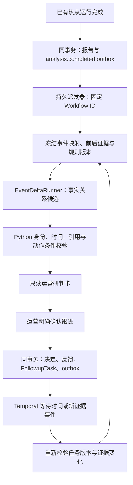

# 运营判断与持续跟进：技术实施与跨机部署交接

更新：2026-10-26。状态：**待实现设计与交接说明**。本次只提交文档，不包含新功能、迁移、模型调用、运行测试或部署结果。

源码核对基线：`a325089ae8a09f82b47be0fe8189bf138a25b6ac`。下文区分“已有代码”和“建议新增”。迁移编号、参数门槛和新增命令须由实施者核对目标机器的最新代码后确定。本文全部文件链接使用仓库相对路径，适用于 GitHub 与另一台电脑。

## 0. 接手目标与边界

目标用户是新闻运营。围绕一次事件回答：这次新增了什么事实、哪些是重复报道、是否发生更正、原建议是否仍有效，以及谁在何时继续跟进。

第一版建议只覆盖一个栏目、已保存的热点运行、事件事实增量卡和人工确认后的跟进任务。复用 Python 原生模型 Port、Pydantic、PostgreSQL 和 Temporal；不引入第三方 Agent 框架，不改权威指标计算，不自动发布或投递，不将个人经验自动共享。

首先阅读 [AGENTS](../../AGENTS.md)、[项目上下文](../../DemoMD/PROJECT_CONTEXT.md)、[长期设计参考](../../DemoMD/TAOTIAN.md) 和 [本地运行](local-bge-simulation.md)。项目上下文指定 WSL 为主工作区；不能用 Mac 的源码检查或 Windows 容器的历史测试替代目标部署验证。

完成标准分三层：

1. **工程闭环**：有幂等输入、冻结快照、可恢复派发、权限边界、故障测试和逐任务证据。
2. **判断质量**：在冻结事件序列上，与原单窗分析对照，评价新增事实、更正与建议依据。
3. **运营价值**：小范围人工试用，观察判断耗时、重复阅读、漏跟和修改成本；不由采纳率直接推断正确率或 CTR 收益。

## 1. 已有代码与精确接入点

| 已有实现 | 事实与实施含义 |
| --- | --- |
| [热点编排](../app/modules/hot_news/application/hot_news_orchestration.py) | 指标、基线、排名、内容富化、分析已有实现；新功能消费其保存结果 |
| [输入构造与校验](../app/modules/hot_news/analysis/hot_news_analysis.py) | 有身份、指标 key、证据 ID、Memory 白名单和推断标记；尚不能证明逐句语义都受证据支持 |
| [OperationSuggestion](../app/modules/hot_news/contracts/hot_news.py#L167) | 当前是 action/rationale/priority/引用；建议新增独立版本化研判卡，不原地破坏报告 1.0 |
| [save_completed](../app/modules/hot_news/adapters/hot_news_run_store.py#L67) | 在自身数据库事务保存报告，插入与重复命中两条分支均需考虑新请求的幂等处理 |
| [HotNewsActivities](../app/modules/hot_news/workflows/activities.py#L175) | 先保存报告，再收反馈，再更新事件；事件更新失败仅降级，completed 重放也不会自动补事件推进 |
| [事件生命周期](../app/modules/hot_news/application/hot_event_lifecycle.py) 与 [事件仓库](../app/modules/hot_news/persistence/hot_event_repository.py) | 已有成员/热度/次数/状态；读、规划、upsert 不在同一事务，upsert 未做版本 CAS，不能直接当并发安全事实前态 |
| [运营决定](../app/modules/hot_news/application/hot_news_decision.py) | 新的采纳、延后、拒绝、修正都能同事务进入反馈；不要重复建设这个能力 |
| [决策合同](../app/modules/hot_news/contracts/hot_news_decision.py) | deferred 尚无责任人、到期条件与复核状态合同 |
| [writing outbox 表](../app/modules/writing/persistence/outbox.py) 与 [Relay](../app/modules/writing/outbox.py) | 绑定非空 writing_jobs 外键、UUID 租户与 ProgressEvent，发布的是 Redis 进度；只能借鉴模式，不能直接塞热点任务 |
| [分钟实验链](../simulation/streaming_lab/bridge.py) | 独立调用热点编排并保存自己的结果，不能假设已走标准 HotNewsActivities 或标准报告表 |
| [运营主线评分](../evaluation/operations_evolution_eval.py) | 已有时序素材、理由/决策/证据 ID/修订字段评分；缺口是事实增量语义与动作依据，不是再建一套样例 |

### 必须先解决的两个事务边界

**报告→请求：** 在 `PostgresHotNewsRunStore.save_completed()` 的同一个 session 中写 `analysis.completed` 业务 outbox。请求先绑定真实 `run_id`、保存的 payload hash、处理版本，不依赖当时可能尚未生成的 `event_key`。`Database.session()` 在退出时提交；提交成功后才允许派发。

重复命中分支应基于**已保存的 payload**重建身份，比较现有 outbox 指纹；不要用重试时重新生成的不同输出覆盖旧请求。`get_completed` 快速返回的历史报告不会自动经过 `save_completed`，需要显式范围的 backfill/reconcile 作业。该作业不得在普通只读 GET 中隐式触发。

**请求→事件前后态：** 消费请求后，在短事务里锁定事件映射/序列，冻结前后快照；离开事务再调用模型。新流程启用范围内，原先可降级的生命周期更新与新消费者必须选定唯一写入方，避免双写。

若初期复用按租户 `list_open` 的连通合并策略，可在同一数据库 session 内串行化该租户的事件规划与写入；所有相关写入方必须遵守同一锁/CAS 协议。仅在外层加锁、内部继续各开事务无效。后续再细化为按事件并发。

## 2. 建议架构和调用链



M1 先实现一个 `EventDeltaRunner`，允许同一次结构化输出包含事实变化和候选动作，再由 Python 门禁筛选。只有评测证明职责拆分有价值时，M2 才将“事实分析→运营建议”拆为顺序模型调用。互不依赖的检查可并行，但必须共享总预算、取消和等待所有子任务；不能让主任务失败后子模型继续消耗预算。

分钟实验链第二阶段通过明确 Adapter 接入同一请求合同。首次上线不得将它的 `snapshot_id` 伪装成标准 `analysis_runs.run_id`；使用 `source_kind/source_id/source_hash` 区分来源。M1 只支持 `standard_hot_news_run`，其他类型显式返回不支持。

## 3. 建议新增代码结构

以下是**拟新增路径**，当前不存在；不要直接运行这些模块。

```text
agent/app/modules/hot_news/
  contracts/
    event_review.py              # 快照、证据、变化、研判卡，严格版本合同
    event_followup.py            # 人工命令、触发条件、任务状态
  analysis/
    event_delta.py               # 模型 Runner + 输入预算 + 输出校验
  application/
    event_review.py              # 冻结输入、执行、保存结果、失效处理
    event_followup.py            # 确认/改期/取消/转交，事务和权限
  persistence/
    event_review.py              # ORM
    event_followup.py            # ORM
    operations_repository.py    # 事务、CAS、租约、查询
    operations_outbox.py        # 独立业务派发表
  workflows/
    event_review.py
    event_followup.py
    operations_activities.py
  operations_api.py              # 既有鉴权依赖 + 新路由

agent/app/bootstrap/operations.py # API/Worker/Port 装配
agent/app/operations_worker.py    # 显式 Worker 入口
agent/app/operations_dispatcher.py
agent/evaluation/event_delta.py   # 冻结输入与确定性评分器
agent/evaluation/run_event_delta.py
agent/alembic/versions/<新revision>_event_operations.py
```

新 Alembic revision 从目标分支当前 head 生成，不在文档中预占编号；同步 ORM 注册、env import、Worker 注册、`pyproject.toml` 脚本入口及打包资源。原模块的兼容 shim 继续只导出，不在旧目录实现第二套逻辑。

## 4. 数据合同：先冻结输入，再解释变化

### 4.1 EvidenceRef 与事件快照

| 字段 | 约束 |
| --- | --- |
| tenant_id / corpus_scope | 服务端身份与批准语料范围，不由模型传入 |
| news_id / source_release / content_hash | 精确绑定正文身份；同一 news_id 的不同版本不能混用 |
| evidence_id | 服务端为冻结片段分配，模型只能引用 |
| start / end / quote_hash | 对冻结文本的半开区间，明确单位为 Unicode code point；端侧不能拿 JS UTF-16 偏移直接比较 |
| published_at / observed_at | 分别表示来源发布时间与本系统可见时点；两者不能互代 |
| source_status | 可用、已撤回、受限或待核查，由可信内容 Port 提供 |
| as_of / window / watermark | 回放时使用当时可见数据；不以执行当天替代观察时点 |

片段必须能从不可变文本按同一规范化规则重建；记录规范化版本。`quote_hash` 核对引用身份，不证明该句支持模型的语义结论。没有可靠 observed_at 的素材应标明限制，不宣称真实历史可见性已验证。

新快照包含 `event_key、event_mapping_version、source_kind/source_id/source_hash、predecessor_snapshot_id、snapshot_revision、input_hash、policy_version、Prompt/model/Schema/Validator 版本`。当前报告的片段可用于第一版，但必须显式记录裁剪；不得把裁剪窗口中没有出现的事实称作“世界上不存在”。

不要对同一主体的所有报道直接合并。事件关系至少区分 `same_event、background、related_topic、uncertain`；M1 可使用运营确认或已审核事件组，模型只给关系候选。对歧义保持分开并标记待核实。

### 4.2 FactChange

建议合同：`added、repeated、corrected、conflicting、invalidated、unresolved`，附旧/新 claim 引用和 evidence_refs。`claim_id` 由持久快照中的声明记录分配，不能允许模型生成一个 ID 后直接获得可信身份。

- 新事件没有前态：标记 `initial_snapshot`，不能计作“相比上一轮全是新增”。
- 相互矛盾：优先 conflicting；更正需要明确更正来源或经审核规则支持，不使用“后来发布的一定正确”。
- 来源撤回：标记引用不可用于当前建议；保留历史解释，不自动判定所有历史事实为假。
- 仅热度变化：指标差由 Python 产生，不等于内容事实增加。
- 迟到窗口：保存独立修订并关联 supersedes，不覆盖较新当前快照；若确需重算后续差分，创建显式重算链。
- 事件合并：记录 alias/合并版本；已有任务转为待复核，不能静默丢失责任人与历史建议。
- 前态缺失或证据不足：输出 blocked/unresolved 及原因，不生成可直接采用的确定建议。

### 4.3 DecisionCard

新卡使用 `schema_version=event-decision-card-v1`，保留旧 `HotNewsAnalysisReport` 合同。核心字段：

```text
card_id, tenant_id, event_key, review_run_id, snapshot_id
changes[], metric_change_refs[], evidence_refs[]
action_type: update_content | add_context | verify_source | observe | review_previous_content
rationale, priority, preconditions[], invalidation_conditions[]
proposed_review_at, expires_at, limitations[]
policy_version, status: draft | ready_for_review | blocked | superseded | expired
```

动作种类来自注册白名单，条件使用严格结构化字段，不接受模型提供的 SQL、Python、URL 或任意表达式。来源失效、证据冲突、范围错配、时点不符属于前置门禁；优先级不能覆盖门禁。模型自报 confidence 仅作分析字段，不当作校准概率或自动批准阈值。

## 5. PostgreSQL 表与一致性约束

建议 M1 使用前三张；M2 开启跟进时再增加后三张。最终 DDL 需随迁移和测试实现，以下为逻辑合同。

| 表 | 核心字段与唯一约束 |
| --- | --- |
| hot_operations_outbox | id、tenant_id（与热点字符串合同一致）、event_type、source_ref、fingerprint、status、attempts、available_at、lease_owner、lease_until、lease_version、workflow_id、last_error_code；UNIQUE(tenant_id,event_type,dedup_key) |
| hot_event_fact_snapshots | id、tenant_id、event_key、event_mapping_version、predecessor_id、revision、as_of、source_ref、input_hash、evidence_manifest、claims、policy_version；UNIQUE(tenant_id,event_key,source_fingerprint,policy_version) |
| hot_event_review_runs | id、tenant_id、snapshot_id、attempt_group、model/Prompt/Schema版本、status、result、validation_result、budget、usage、error_code；UNIQUE(tenant_id,snapshot_id,review_spec_hash) |
| hot_event_followup_tasks | id、tenant_id、owner_user_id、decision_id、event_key、based_on_snapshot_id、generation、status、trigger_rule、next_review_at、expires_at、review_count、max_reviews、confirmation_record；UNIQUE(tenant_id,creator_user_id,idempotency_key) |
| hot_event_followup_executions | id、tenant_id、task_id、generation、trigger_key、target_snapshot_id、status、review_run_id、attempts；UNIQUE(tenant_id,task_id,generation,trigger_key) |
| hot_event_followup_audit | append-only；task_id、generation、actor_id、action、before/after状态、原因、发生时间、请求ID；租户隔离，记录真实操作者 |

所有关联必须校验同租户；优先使用复合唯一键/外键约束并辅以服务端检查，不能只在列表查询里做过滤。不要把热点字符串 tenant 强制转换成写作表的 UUID，公共内容域与业务租户通过明确绑定关联。

`generation` 用于防止旧任务继续执行；不是时间戳。改期、取消、转交和确认新快照时递增，并对 `expected_generation` 做 CAS，冲突返回 409。审计保留操作历史，不能仅覆盖任务 JSON。

快照与研判结果不可变；状态和“当前有效指针”可变。事实关系被修正时创建新 revision，并使旧卡 superseded，不改旧引用。

模型调用不持数据库锁。M1 可在有上限的 JSONB 中保存结果；若使用 MinIO，先上传以哈希为身份的不可变对象，再在数据库提交引用，并通过对账清理孤儿对象；不要声称对象存储与 PostgreSQL 原子提交。

## 6. 持久派发与 Temporal

### 6.1 Outbox 派发

1. 报告与 outbox 同事务提交，失败则两者回滚。
2. 派发器以 `FOR UPDATE SKIP LOCKED` 有界领取，写入租约和 fencing version 后提交，再执行网络请求。
3. 固定 Workflow ID，例如 `event-review:<tenant-hash>:<outbox-id>:v1`；参数携带业务 fingerprint。
4. Temporal 接受但响应丢失时，按固定 ID 查询并核对 fingerprint；不生成新 UUID 重提。
5. 成功标记 dispatched 只代表已受理，不能标记分析完成。完成由持久 review 结果与 Workflow 状态核对。
6. 过期租约可重新领取；旧 owner 更新必须携带 lease_version 并通过 CAS。累计失败达到注册上限后转 dead_letter，保留可诊断状态。
7. 定期对账已保存报告缺请求、请求缺 Workflow、Workflow 完成但结果未登记等情况。历史回填要求显式租户、运行范围、处理版本、上限和 dry-run。

“同 key 不同 fingerprint”必须冲突，不能覆盖。Temporal 的 Activity 重试与派发器重试分别计算，避免二者相乘造成无界模型调用。非确定性模型调用成功后、结果持久化前硬崩溃仍可能重复调用；能用 provider 幂等时复用，否则保守计费/预留预算并明确只能保证业务结果幂等。

既有 [AdmissionService](../app/modules/conversation/admission.py) 的固定身份与指纹核对可作参考，但其 dispatch 分支目前限定 writing/evaluation。M1 建独立 OperationsDispatcher，不把 followup 类型直接塞进旧 else 分支。

### 6.2 Review Workflow

建议阶段：`load_source → resolve_event_and_freeze → infer_delta → validate_and_store → publish_projection`。

- 每个 Activity 输入只传稳定 ID/版本，正文与大结果留在持久存储，避免塞入无限增长的 Workflow history。
- 冻结阶段保存前后快照引用，模型重试复用同一输入；不得每次重试重新查询 latest。
- 乱序结果只保存到其 review_run；发布当前卡前再 CAS 当前 snapshot/generation，迟到结果不得覆盖新卡。
- 输出校验失败允许至多一次明确预算内修复或直接 blocked；网络重试不能通过新增 review_run 重置总预算。
- 输出引用在落库前和被运营采用前都需核验有效性。源更正使旧卡 superseded，保留原文供审计。

### 6.3 Followup Workflow

首次明确确认后创建任务。建议状态：`scheduled → evaluating → awaiting_operator → completed`，另有 `paused/cancelled/expired/failed`。一次复核完成只会进入 awaiting_operator；整个跟进任务是否完成由业务决定，不能自动混为一谈。

支持 `at_time` 和 `on_material_evidence_change` 两类触发。新证据触发来自可信源变更事件，先比较冻结版本/指纹并合并短时间重复事件，变化达到注册规则才调用模型；时间到期但内容未变时可记录 no_change，不必再次生成长报告。

时间等待使用 Temporal timer；证据变化使用持久事件派发到 Signal/Update 或独立唤醒流程，实施时选定一种并补合同测试。不能把 Redis/SSE 或进程内 sleep 当作跨天任务事实源。

每次唤醒必须重新核验 tenant、owner权限、status、generation、期限、次数预算与当前证据。`trigger_key` 按时间槽或证据 fingerprint 确定，同 generation 下唯一。Activity 重试复用同一个 execution；不能每次重试增加业务复核次数。终态/改期/转交后旧 timer 即使到达也只能安全 no-op。

Workflow ID 可以按 `tenant + task_id + generation` 固定。取消/改期的业务状态先在数据库事务提交，再经 outbox 通知旧 Workflow；即使通知失败，旧 Activity 的版本检查仍阻止执行。新 generation 必须继承累计次数/费用预算，不能通过改期重置成本上限。

## 7. API、权限与前端

以下是拟新增路由，当前不可调用：

| 路由 | 行为 |
| --- | --- |
| GET /api/v1/hot-news/events/{event_key}/reviews | 只读研判版本，带状态、证据与数据截止时点 |
| GET /api/v1/hot-news/reviews/{review_id} | 查询真实结果；queued/running 与 completed 分开 |
| POST /api/v1/hot-news/events/{event_key}/review-requests | 可选管理员补算入口，显式 source_ref/处理版本/幂等键；202 回真实请求 ID |
| POST /api/v1/hot-news/followups | 运营确认并创建决定/任务/派发请求；支持新决定或关联已存在且授权的决定 |
| POST /api/v1/hot-news/followups/{id}/commands | reschedule/cancel/reassign/resolve 等白名单命令，携带 expected_generation 与幂等键 |
| GET /api/v1/hot-news/followups | 按责任人/状态分页查询，服务端强制租户与作用域过滤 |

复用 [热点 API principal](../app/modules/hot_news/api.py) 的可信网关身份。tenant/user 不从模型或客户端 body 采信；owner 默认当前操作者，转交需要被允许的团队作用域与权限。READ 不允许确认跟进，DECIDE 也不自动获得任意他人任务的管理权限；新增权限需注册并有拒绝用例。

对于新决定：在同一个 session 中写决定、既有反馈、跟进任务和 outbox，需要把原 service 的事务内操作抽为内部方法，不能先调用已自行 commit 的 `record_decision()` 再创建任务。对于关联旧决定：验证 tenant、operator授权、run/news/event绑定和当前快照，再同事务写任务/outbox/audit。

确认时重新比较 `based_on_snapshot_id + policy_version + expected_generation`。若正文或建议已变化，返回 409 并显示差异，要求重新判断。旧聊天确认 token 只有短期交互用途，不能充当长期执行授权；任务必须保存具体确认内容、版本、操作者与范围。

前端展示“新增/重复/冲突/更正、来源片段、建议条件、有效期、责任人和下次复核”，并明确无变化、证据不足、失效、排队、失败。新的复核结果沿用同一任务历史，不每分钟重复创建同事件卡片。已有热点报告仍可阅读。

## 8. 模型、配置、预算与可观测性

模型沿 [NativeHotNewsAnalysisRunner](../app/modules/hot_news/analysis/runner.py) 的模式注册独立 scene/Prompt/Schema；企业调用仍只经批准的 InferencePort。提供同 Port 本地确定性替身，明确只用于合同测试。

建议新增配置，**当前尚不存在**；实现后进入 Settings/公开 example 配置与部署模板，禁止只写文档不接装配：

| 配置 | 建议默认/语义 |
| --- | --- |
| OPERATIONS_REVIEW_ENABLED | false；允许注册版本的后台只读研判 |
| OPERATIONS_FOLLOWUP_ENABLED | false；控制新任务创建；关闭时禁止新副作用，已有任务按持久暂停/取消策略处理 |
| OPERATIONS_REVIEW_TENANTS | 显式试点 allowlist，空表示无租户启用 |
| OPERATIONS_TASK_QUEUE | 独立且版本化的 Temporal queue |
| OPERATIONS_POLICY_VERSION | 必填注册版本；运行冻结全文 hash |
| OPERATIONS_MODEL_ROUTE / PROMPT_VERSION | 必须能由运行时注册器解析，不默默回退 local |
| OPERATIONS_MAX_EVIDENCE_ITEMS / INPUT_CHARS | 实施时确定有界值并评测覆盖；字符预算不等于精确 Token |
| OPERATIONS_MAX_MODEL_CALLS / REVIEW_TIMEOUT_SECONDS | 候选起点为最多2次尝试、60秒一次研判；须按所用模型和原有预算校准，包含修复与重试 |
| OPERATIONS_MAX_REVIEWS / TASK_TTL_SECONDS | 每个任务次数与有效期上限，业务确认后注册；改期不能清零 |
| OPERATIONS_DISPATCH_BATCH / CONCURRENCY | 显式小规模起步，按队列积压与资源验证后调整 |

当 provider 有 Token usage 时记录实际消耗；硬成本上限需调用前保守预留及调用后结算。缺少用量信息时不能声称实现了精确 Token 预算。超时、取消、失败调用都进入预算记录。

逐次关联 `request_id、run_id/source_id、event_key、snapshot_id、review_run_id、followup_task_id、execution_id、workflow_id、model_request_id` 与 OTel TraceID。通用遥测只保存安全身份、版本、耗时、重试/门禁原因，不保存正文、Prompt、回答原文和企业用户明细。

观察指标：outbox积压/最老年龄、派发未知状态、snapshot缺失、blocked原因、模型调用/失败、旧版本结果丢弃、到期任务延迟、重复触发、取消后唤醒、dead_letter和对账差异。不要把 accepted/dispatched 状态渲染为完成。

## 9. 评测与测试计划

应用仓库 [newsagent-evaluation 协议](../../skills/newsagent-evaluation/SKILL.md)。先冻结目标和标准，再运行；本节列的是实施要求，**没有本次通过分数**。

### 9.1 质量对照

- A：现有单窗分析；B：同模型与可比预算下的前后事实差分；C：仅在 B 后尝试的职责拆分团队。
- 每个方案各自冻结 Prompt/Schema/配置，明确 A→B 改变的输入与功能，不假称 Prompt 完全相同；分别报告成本与效果。
- 复用 [operations_research](../evaluation/operations_research.py) 和 [operations_evolution](../evaluation/operations_evolution_eval.py) 的时序/盲输入/固定分母机制，增加独立确认的事实关系与允许动作标签。不要把模型生成结果反过来当 gold。
- 六类样本：重复转载、实质新进展、传言后证实/辟谣、事实更正、条件失效、沉寂后再升温；包含证据缺失、乱序与跨租户反例。
- 同事件、转载链和更正链不跨 development/validation/test。观察时间之后的信息和隐藏标签不进入模型输入。

| 目标 | 评分与边界 |
| --- | --- |
| 事实增量 | 人工确认标签下的新事实 Precision/Recall、重复误报、更正/失效漏判；引用未知/未来证据单列硬失败 |
| 动作依据 | 允许动作集合与前置条件匹配、无依据动作率；文案是否误导和证据是否支持由人工盲审 |
| 人工价值 | 同类任务判断耗时、修改量、漏跟、重复阅读；采纳率只作辅助，不能当正确率 |
| 成本 | 每事件/任务调用数、Token、耗时、超时及失败，不从分母移除失败样本 |

主线现有 scorer 的修订字段覆盖不证明语义正确。LLM judge 仅辅助分拣，不能替代独立标签、确定性门禁或人工业务评审。

### 9.2 工程测试矩阵

下列新增测试文件是实施待办：

| 建议测试 | 必须覆盖 |
| --- | --- |
| test_event_review_contracts.py | 引用版本/片段哈希、时区、身份错配、未知动作、初始快照、缺前态、冲突不能自动更正 |
| test_event_review_transactions.py | report与outbox同成败、重复命中指纹冲突、completed快速重放后的显式回填、双租户隔离 |
| test_event_snapshot_concurrency.py | 并发窗口、迟到修订、CAS失败、唯一写入方、旧结果不覆盖新卡 |
| test_operations_dispatcher.py | Temporal接受后响应丢失、固定ID核对、租约过期、旧owner fencing、死信与恢复 |
| test_event_followup_service.py | 明确确认、过期快照409、决定/反馈/任务/队列原子性、改期/转交/取消权限与幂等 |
| test_event_followup_workflow.py | 虚拟时钟到期、重复证据、重启恢复、旧generation no-op、预算耗尽、单次执行唯一 |
| test_event_delta_evaluation.py | 按事件split、无未来/答案泄露、固定分母、未知证据、未审核标签阻断正式评分 |
| e2e/test_event_operations.py | 隔离PostgreSQL+Temporal+同Port替身，API→请求→Workflow→结果→人工命令→复核终态 |

故障注入点至少包括：数据库提交前/后、Temporal接受后确认前、模型返回后保存前、结果保存后Workflow确认前、取消提交后通知前。分别验证业务幂等与可能重复的外部推理成本，不宣称跨系统 exactly-once。

可复用的现有测试： [热点Activity](../tests/test_hot_news_activity.py)、[事件生命周期](../tests/test_hot_event_lifecycle.py)、[运营决定](../tests/test_hot_news_decision_service.py)、[运营主线](../tests/test_operations_evolution.py)、[Data Loop回放](../tests/test_data_loop_analysis_replay.py)、[分钟查询](../tests/test_streaming_window_query.py)。含真实依赖的用例须显式准备隔离环境；skip 不等于 passed。

## 10. 分阶段实施建议

| 阶段 | 提交范围 | 出口条件 |
| --- | --- | --- |
| M0 合同与冻结 | 新Schema、来源Adapter合同、版本、试点事件集、评测规格 | 不需要模型也能验证身份/时间/盲输入，明确当前事实源和前态选择 |
| M1 只读增量卡 | 三张表、事务请求、派发器、快照、单Runner、读API/卡片 | 故障恢复和租户测试通过，逐例质量对照可追溯；默认关闭 |
| M2 人工跟进 | 三张跟进表、确认命令、timer/证据触发、取消/改期/转交 | 完整确认与恢复链通过，旧任务不能继续执行，累计预算不重置 |
| M3 分钟链与语料一致性 | 明确来源Adapter，当前内容版本门禁，事件关系核验 | 5/15分钟独立来源准确接入、scope不混用，不引用已撤回当前素材 |
| M4 可选优化 | 拆分专家、多窗口联合策略、规则调参 | 同一冻结对照证明增益，同时报告延迟、成本和关键分组退化 |

提交粒度按阶段拆分，避免一次性改动旧报告Schema、标准链、分钟实验链、推送与Data Loop。现有正文release到索引的传播仍是独立依赖：初期输入必须显式绑定有效内容版本，不能假设所有历史向量已同步撤出。

## 11. 另一台电脑的实施与部署顺序

### 11.1 拉取文档并核对分支

在目标机器的 **NewsAgent 主工作区**执行。先核对工作区，不自动覆盖、reset或stash另一台电脑已有改动：

```bash
git status --short
git branch --show-current
git remote -v
git fetch origin
git log --oneline --decorate -5 origin/main
```

若当前就是干净的 main，且本地没有分叉提交，可执行：

```bash
git pull --ff-only origin main
git switch -c feat/event-operations-followup
```

若已有未提交修改或分叉，先保留并核对差异，使用自己的实施分支合并/cherry-pick文档提交；不要用强制同步。打开 `agent/docs/operations-judgment-followup-implementation.md`。本提交只交付建议，拉取后不会自动出现新API/Worker。

### 11.2 编码前预检

1. 核对目标机器的 AGENTS、上下文、HEAD、未提交修改与迁移heads。
2. 确认实际服务运行的是 WSL工作区、Windows副本还是已构建镜像；比较挂载路径和镜像对应提交，避免修改A目录却重启B目录。
3. 确认已有数据库/Temporal/Redis/MinIO实例属于哪套隔离栈。保留数据卷、已批准Bundle、冻结素材和密钥，禁止重新造空库冒充现状。
4. 不复制 Mac 的 `.env` 或本地模型目录。使用目标机器的批准配置，文档只提供变量名。真实模型、Embedding、本地替身与合成数仓分别标识。
5. 在当前已安装依赖环境执行相关基线测试，记录通过、失败和跳过；本文件不要求先做大规模模型推理。

### 11.3 实现完成后的部署步骤

这些是**完成代码后**的部署顺序，不是当前可直接一键执行的新功能命令：

1. 备份目标数据库并在隔离恢复副本演练新增迁移；以实际 Alembic head 确认升级路径，避免生成分叉head。
2. 在新功能关闭状态下应用兼容迁移；旧服务必须能继续读取原报告和决定。
3. 构建并发布包含新代码的 Worker/dispatcher，注册独立task queue；使用目标机已有部署规范，不假造当前不存在的Compose服务名。
4. 发布同版本API/前端，核对依赖装配、路由、公开example配置和健康检查。记录实际镜像/提交身份。
5. 在显式测试租户启用只读研判，运行一个已知run → outbox → Workflow → card 全链路，核对数据库终态、来源hash和Trace。
6. 故意重发同一请求、重启dispatcher/Worker，验证无重复业务结果、不会漏任务；检查dead_letter与积压。
7. 只读阶段达标后启用人工跟进，用测试操作者确认一次任务，验证到期、改期、取消、转交和旧timer失效。
8. 再做模型质量与运营试用。代码部署成功不等于质量通过，也不授权生产Prompt/规则激活或真实发布。

### 11.4 回滚与停止

- 先关闭新建入口，并在持久任务状态中暂停/取消选定任务；每次执行前都要检查全局开关与任务状态。
- 必要时暂停dispatcher；保留能够处理取消和读取旧Workflow history的兼容Worker，不能只停进程就宣称任务已取消。
- 原报告功能继续运行；新卡标明暂停/失效。保留outbox、快照、审计与已完成结果，不清卷、不删除追溯记录。
- 不默认执行破坏性数据库downgrade。回滚应用与关闭新增功能优先，迁移逆操作另行验证。
- 尚未派发、已受理、正在模型调用、等待人工、等待timer的任务分别盘点，给出真实状态。

## 12. 接手实现时的验收交付清单

- [ ] API/合同/状态机与本设计一致；偏离处写出理由和迁移策略。
- [ ] 决策质量与任务可靠性分别有证据，不用总体平均分掩盖硬失败。
- [ ] 上游入口→转换→Service/Runner→Port→持久化→下游展示的完整调用链已记录。
- [ ] 新配置实际接入Settings、装配、Worker与部署模板，默认关闭且有负向测试。
- [ ] 迁移、测试和运行命令可在目标主工作区复现，明确依赖、skip、模型身份与数据来源。
- [ ] 每例包含真实request/run/event/review/task/workflow引用、状态、重试、耗时与Trace证据。
- [ ] 历史数据回填范围、错误恢复、暂停取消和版本回退均可审计。
- [ ] 未完成项逐条列出；本地替身不描述成模型质量，合成行为不描述成企业效果。

本次文档交付调用链：静态核对已有业务、事务、Worker、模型与评测代码 → 编写待实施合同与分阶段计划 → 校验仓库相对链接和Git差异 → 提交GitHub → 由另一台电脑实施、测试和部署。新增模块/API/表/开关目前均未实现，企业接口、模型质量、负载及真实运营效果均未在本轮验收。
